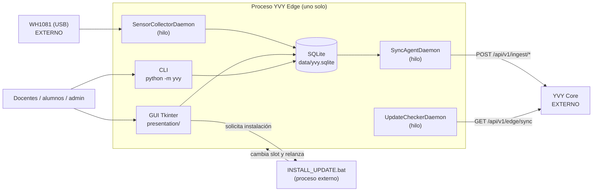
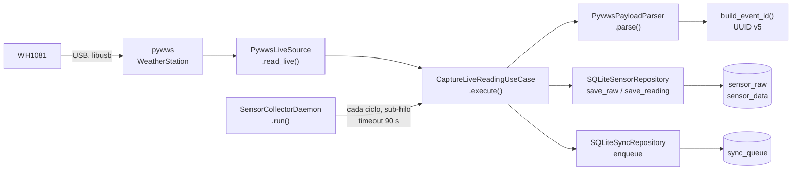
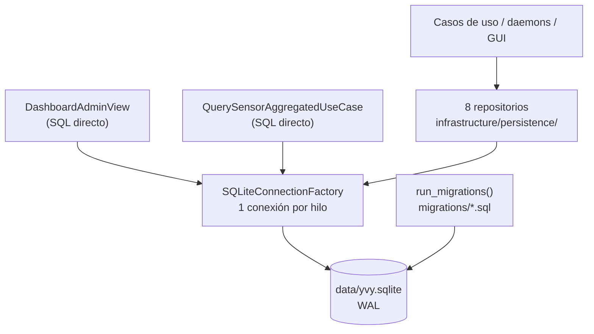
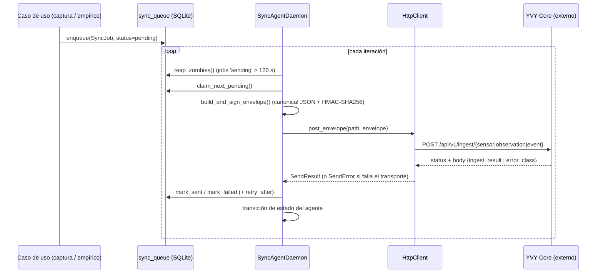
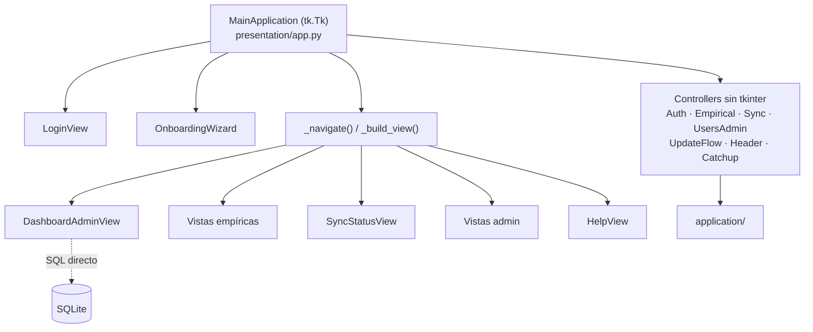
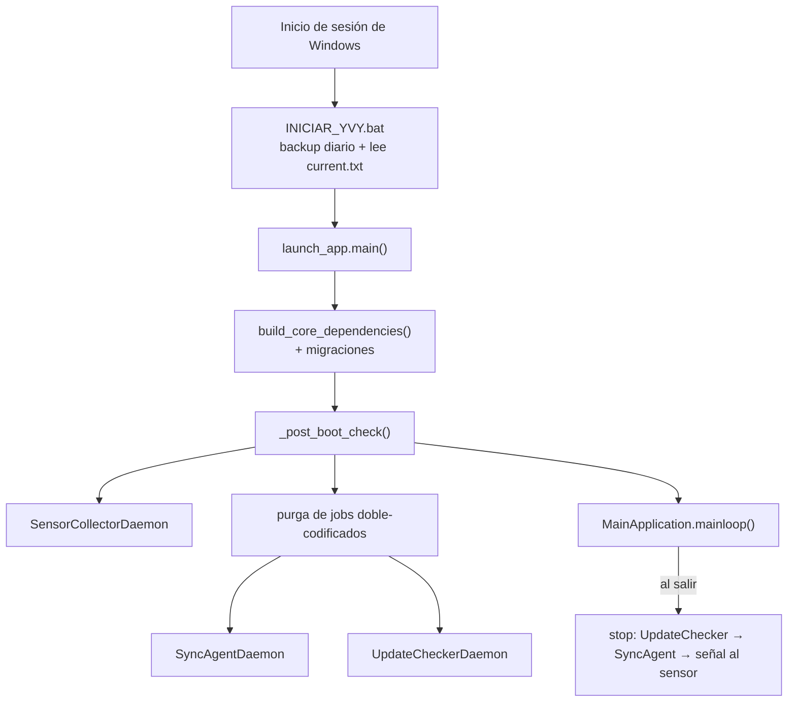
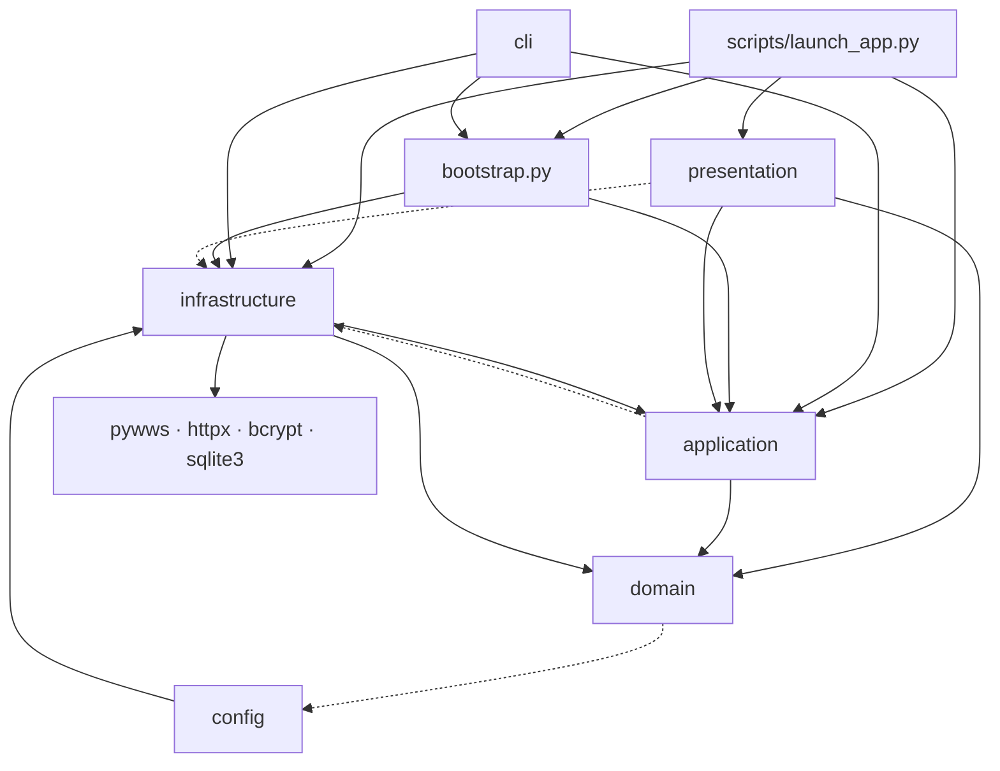
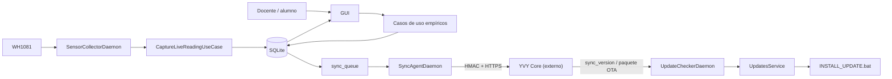

# Arquitectura actual — YVY Edge

> Documenta **exclusivamente** la arquitectura que puede demostrarse en el repositorio: código,
> configuración, tests y scripts. No describe una arquitectura ideal ni propone cambios.
> Donde la documentación del repositorio afirma algo que el código no cumple, se dice.

| Campo | Valor |
|---|---|
| Software | YVY Edge `v1.6.0` (`src/yvy/__init__.py::__version__`) |
| Commit verificado | `e400ebb0696fefdb61a10a8ef4024f0435783c70` · rama `stab/ini-1-higiene` |
| Fecha | 2026-10-07 |
| Base | Lectura directa de código + `grep` de imports/usos; [`MAPA_DEL_CODIGO.md`](MAPA_DEL_CODIGO.md) como índice |
| Documentos relacionados | [`MAPA_DEL_CODIGO.md`](MAPA_DEL_CODIGO.md) (nivel archivo/función) · [`architecture/`](architecture/README.md) (Arquitectura de Referencia, ver §3.3 sobre sus discrepancias) · `CONTRATOS_Y_DICCIONARIOS_DE_INTERFACES.md` (vive **fuera** de este repo, en `I:\.YVY_IEAProject\`) |

**Niveles de evidencia usados:** `VERIFICADO EN CÓDIGO` · `VERIFICADO EN CAMPO` (con documento de
certificación citado) · `NO VERIFICADO` · `REQUIERE VALIDACIÓN` · `NO ENCONTRADO`. Si una afirmación no
lleva etiqueta, es `VERIFICADO EN CÓDIGO`.

---

## 1. Alcance y propósito

**Qué es, según el repositorio:** una aplicación de escritorio Python (`pyproject.toml`:
`python = "^3.11"`; runtime real 3.12, ver §11) con GUI Tkinter, que corre como **un único proceso**
con tres hilos daemon (`scripts/launch_app.py::main`).

**Responsabilidad dentro de YVY** (derivada de lo que el código hace):

- leer una estación **Fine Offset WH1081** por USB a través de `pywws`;
- validar y persistir esas lecturas en una base **SQLite** local;
- registrar observaciones y eventos meteorológicos cargados por personas;
- encolar todo y enviarlo firmado con **HMAC-SHA256** a un servidor externo (YVY Core);
- consultar a ese servidor si hay una versión nueva del software, descargarla e instalarla
  (OTA por *slots*).

**Problemas que resuelve** (evidencia: diseño del código, no marketing):
- operación sin red — toda la captura y carga es local; la red sólo se usa para sincronizar;
- cortes de USB/energía — recuperación del buffer del sensor (*catchup*) y deduplicación por
  `event_id` determinístico;
- actualización sin técnico en sitio — instalador externo con watchdog y rollback.

**Componentes externos que necesita:** el sensor WH1081 + driver USB; Windows (los scripts de
despliegue son `.bat`); YVY Core (sólo para sincronizar y actualizar — no es necesario para operar).

**No es responsabilidad de Edge:** ver §18.

---

## 2. Vista general de arquitectura

Sólo componentes comprobados. YVY Core y el sensor son externos al repositorio.



> El CLI es un proceso **separado** cuando se ejecuta (`python -m yvy ...`); comparte la misma base
> SQLite pero no arranca daemons ni GUI (`src/yvy/cli/__main__.py`).

---

## 3. Capas / módulos reales

### 3.1 Organización encontrada

Paquetes bajo `src/yvy/`: `domain/`, `application/`, `infrastructure/`, `presentation/`, `cli/`,
`config/`, más `bootstrap.py` y `main.py`. Fuera de `src/`: `scripts/launch_app.py` (arranque de la
GUI) y `migrations/` (SQL).

| Módulo | Responsabilidad | Ubicación | Dependencias reales (verificadas por imports) | Estado |
|---|---|---|---|---|
| Domain | Modelos inmutables, reglas, máquina de estados del agente de sync, Protocols de repositorio | `src/yvy/domain/` | stdlib + **`yvy.config.constants`** (sólo `sensor/event_id.py`) | IMPLEMENTADO |
| Application | Casos de uso, `UpdatesService`, puertos (`ports/`) | `src/yvy/application/` | `domain` + **`infrastructure` en 6 módulos** (ver §3.3) | IMPLEMENTADO |
| Infrastructure | SQLite, pywws, HTTP+HMAC, bcrypt, OTA, daemons | `src/yvy/infrastructure/` | `application`, `domain`, libs externas; **no** importa `presentation`/`tkinter` (gate AST) | IMPLEMENTADO |
| Presentation | GUI Tkinter: ventana, vistas, componentes, controllers, gráficos | `src/yvy/presentation/` | `application`, `domain` + **`infrastructure` en 8 archivos** (ver §3.3) | IMPLEMENTADO |
| CLI | Diagnóstico y operación por línea de comandos | `src/yvy/cli/` | `bootstrap`, `application`, `infrastructure` | IMPLEMENTADO |
| Config | Rutas (`paths.py`) y constantes (`constants.py`) | `src/yvy/config/` | `infrastructure.system.paths` | IMPLEMENTADO — `constants.py` mayormente sin uso (ver §12) |
| Composition Root (núcleo) | Construye factory SQLite, 8 repos, reloj, `UpdatesService` | `src/yvy/bootstrap.py::build_core_dependencies` | infrastructure + application | IMPLEMENTADO |
| Launcher (extensión del root) | Construye casos de uso, 4 controllers, 3 daemons, GUI | `scripts/launch_app.py::main` | todo lo anterior | IMPLEMENTADO — fuera de los gates de CI |

### 3.2 Patrón observado

Lo que el código muestra:
- **Puertos y adaptadores, en su mayor parte.** Hay `Protocol` reales (`application/ports/`,
  `domain/*/repository.py`, puertos angostos como `SyncVersionReader` en `sync_agent.py`) y adaptadores
  que los satisfacen por estructura, sin herencia.
- **Composition Root explícito**, partido en dos archivos (`bootstrap.py` + `launch_app.py`), sin
  framework de inyección.
- **Controllers de presentación sin `tkinter`** (7 en `presentation/controllers/`), con decisión pura
  separada del pintado; 4 se construyen en `launch_app.py` (`EmpiricalController`, `AuthController`,
  `UsersAdminController`, `SyncController`) y 3 dentro de `presentation/app.py` (`UpdateFlowController`
  línea 247, `HeaderController` línea 262, `CatchupController` línea 278).

Calificarlo como "hexagonal" es correcto **con las excepciones de §3.3** — no es una aplicación pura de
la regla de dependencia.

### 3.3 Dónde el código no cumple la regla de dependencia documentada

`docs/architecture/02_convenciones_e_invariantes.md` declara DEP-1 ("`domain/` sólo stdlib") y DEP-2
("`application/` nunca importa `infrastructure`"). El código actual:

| Regla documentada | Lo que hace el código | Evidencia |
|---|---|---|
| DEP-1: domain sólo stdlib | `domain/sensor/event_id.py` importa `yvy.config.constants.YVY_NAMESPACE` | `event_id.py:41` |
| DEP-2: application no importa infrastructure | 6 módulos lo hacen: `admin/export_data_csv.py:21`, `admin/export_raw_csv.py:25`, `admin/import_data_csv.py:32` y `query_sensor_aggregated.py:36` (`SQLiteConnectionFactory`); `retention/run_retention_job.py:38` y `sensor/run_catchup_recovery.py:61` (`AppMetricsRepository`) | `grep "from yvy.infrastructure" src/yvy/application` |
| DEP-4: presentation consume application y recibe lo demás inyectado | 8 archivos de `presentation/` importan `infrastructure` (`HelpRepository`, `SQLiteConnectionFactory`, `AppConfigRepository`, `AppMetricsRepository`, `SyncAgentDaemon`); además `DashboardAdminView._query_kpis()` ejecuta **SQL directo** contra `sensor_data` | `views/dashboard_admin.py:271-300` |

Estas fugas no las detecta ningún gate: el gate AST sólo verifica que `infrastructure` no importe
`presentation`/`tkinter` (regla B), y el gate de tipos no evalúa dirección de imports.

---

## 4. Componentes principales

Detalle por archivo y función en [`MAPA_DEL_CODIGO.md`](MAPA_DEL_CODIGO.md) §5; acá, sólo lo necesario
para entender la arquitectura.

| Componente | Responsabilidad | Ubicación / clases principales | Entradas → Salidas | Relación |
|---|---|---|---|---|
| Adquisición | Leer el sensor en vivo y recuperar su buffer | `infrastructure/pywws/live_source.py::PywwsLiveSource`, `catchup_source.py::PywwsCatchupSource`, `parser.py::PywwsPayloadParser` | trama USB → `RawPayload` + `SensorReading` | alimenta a los casos de uso de captura |
| Casos de uso de captura | Orquestar leer → parsear → persistir → encolar | `application/use_cases/sensor/capture_live_reading.py::CaptureLiveReadingUseCase`, `run_catchup_recovery.py::RunCatchupRecoveryUseCase` | — → `CaptureResult` / `CatchupResult` | usa repos de sensor y sync |
| Observaciones empíricas | Validar y persistir carga humana | `application/use_cases/empirical/create_empirical_observation.py`, `create_empirical_event.py` | formulario → fila + job de sync + auditoría | invocado por `EmpiricalController` |
| Persistencia | Contrato de conexión + repositorios | `infrastructure/persistence/connection.py::SQLiteConnectionFactory` + 8 repos | — | usado por todo el sistema |
| Sincronización | Drenar la cola, firmar, enviar, clasificar respuesta | `infrastructure/sync/sync_agent.py::SyncAgentDaemon`, `envelope_builder.py`, `hmac_signer.py`, `canonical_json.py`, `http_client.py::HttpClient` | `sync_queue` → HTTP → estado del job | hacia YVY Core |
| Actualización (OTA) | Detectar, descargar, instalar, verificar arranque, revertir | `application/services/updates_service.py::UpdatesService`, `infrastructure/sync/update_checker_daemon.py`, `update_downloader.py`, `infrastructure/updates/installer.py`, `retention.py`, `application/use_cases/updates/post_boot_check.py` | metadata de Core → slot nuevo | `INSTALL_UPDATE.bat` ejecuta el cambio |
| GUI | Ventana, navegación, pantallas | `presentation/app.py::MainApplication`, `views/`, `components/`, `controllers/`, `charts/` | interacción → casos de uso | consume application (y parte de infrastructure, §3.3) |
| CLI | Diagnóstico y operación | `cli/__main__.py::main`, `cli/handlers/` | argumentos → reporte + exit code | abre su propia conexión a la misma base |
| Composition Root | Cablear la infraestructura una vez | `bootstrap.py::build_core_dependencies` → `CoreDependencies` | ruta estable → bundle inmutable | usado por launcher y CLI |

---

## 5. Flujo de adquisición



| Aspecto | Detalle | Evidencia |
|---|---|---|
| Inicio | `SensorCollectorDaemon.run()` en loop, arrancado por `launch_app.py` (línea 315) sólo si `pywws`/sensor están disponibles | `infrastructure/scheduling/sensor_collector.py:75` |
| Cadencia | La impone el hardware: `read_live()` **bloquea** hasta la próxima transmisión (el docstring dice "~48 segundos"). No hay `sleep` entre ciclos | `sensor_collector.py:41`, `:144` |
| Protección ante cuelgue | Cada ciclo corre en un sub-hilo con `join(timeout=90)`; si vence, se registra falla y se espera un backoff | `sensor_collector.py:91-108` |
| Transformación | dict crudo → `RawPayload` (crudo íntegro) + `SensorReading` (validado, `is_valid`, `validation_notes`); timestamp canonicalizado al minuto en UTC | `parser.py::parse` (línea 74), `domain/shared/time_utils.py::canonicalize_to_minute_utc` |
| Identidad | `event_id = uuid5(YVY_NAMESPACE, f"{station_uuid}\|{ts}")` — mismo instante físico ⇒ mismo id (live o catchup) | `domain/sensor/event_id.py:46` |
| Validaciones | estación no coincide, timestamp futuro, payload malformado, timestamp inválido → la lectura se descarta con log, sin propagar | `capture_live_reading.py:105-120` |
| Persistencia | `sensor_raw`, luego `sensor_data` con `raw_id`, luego job en `sync_queue` | `capture_live_reading.py:122-162` |
| Errores de base | propagan al daemon, que los loguea (traceback completo los 3 primeros consecutivos, luego 1 línea cada 30) | `sensor_collector.py:110-128` |
| Catchup | `RunCatchupRecoveryUseCase` → `PywwsCatchupSource.read_since()`; pausa el live source para liberar el USB (`request_pause`/`signal_resume`); lock anti-concurrencia en `app_metrics` | `run_catchup_recovery.py:124`, `live_source.py:195,218` |
| Tests | `tests/integration/test_capture_live_to_db.py`, `test_catchup_recovery.py`, `tests/property/test_catchup_idempotence.py`, `test_event_id_idempotence.py`, `tests/unit/infrastructure/pywws/test_catchup_usb_release.py` | — |

---

## 6. Persistencia local



| Aspecto | Detalle | Evidencia |
|---|---|---|
| Motor | SQLite (stdlib `sqlite3`) | `connection.py` |
| Archivo | `STABLE_ROOT/data/yvy.sqlite` — en instalación por slots, `C:\YVY\data\yvy.sqlite`, nunca dentro del slot | `config/paths.py::DB_DEFAULT_PATH`, `bootstrap.py` |
| Conexiones | una por hilo (`threading.local()`), WAL, `synchronous=NORMAL`, `busy_timeout=5000` | `connection.py::_create_connection` (línea 44) |
| Transacciones | `transaction()` context manager con `BEGIN IMMEDIATE` | `connection.py:78` |
| Schema | v15, 8 migraciones forward-only (`001_initial_v8.sql` … `008_updates_v15.sql`), aplicadas contra la tabla `schema_version` al arrancar | `infrastructure/persistence/migrations.py::run_migrations` (línea 117) |
| Tablas activas | `users`, `sessions`, `audit_logs`, `sensor_raw`, `sensor_data`, `empirical_observation`, `empirical_event`, `sync_queue`, `sync_archive`, `sync_audit`, `sync_agent_state`, `app_config`, `app_metrics` | migraciones 001–008 |
| Tablas sin uso en el código | `empirical_data` (borrada en v11), `comments`, `sessions`, `update_log` — `update_log` no se referencia en `src/`; los eventos OTA van a `audit_logs` | `grep "update_log" src` → 0 |
| Repositorios | `SQLiteUserRepository`, `SQLiteAuditLogRepository`, `SQLiteSensorRepository`, `SQLiteSyncRepository`, `SQLiteSyncAgentStateRepository`, `SQLiteEmpiricalRepository`, `AppConfigRepository`, `AppMetricsRepository` | `infrastructure/persistence/` |
| Integridad | `CHECK` de rango y formato en columnas (ej. `observed_at` ISO UTC, `event_id` UUID v5 por GLOB); `UNIQUE(event_id)` en `sensor_raw`, `sensor_data`, `sync_queue` | migraciones |
| Estado concurrente | el *pending* de update se guarda como **una clave JSON** (`update_pending`) para lectura atómica; convive con una escritura duplicada en 9 claves sueltas (legado) | `app_config_repository.py:27`, `:148-183` |
| Backup | copia diaria de la base al arrancar, retención 30 días — lo hace el `.bat`, no Python | `scripts/INICIAR_YVY.bat` |

---

## 7. Sincronización Edge → Core



| Aspecto | Detalle | Evidencia |
|---|---|---|
| Quién genera los datos | `CaptureLiveReadingUseCase`, `RunCatchupRecoveryUseCase`, `CreateEmpiricalObservationUseCase`, `CreateEmpiricalEventUseCase` — son los **únicos** que crean `SyncJob` | `grep "entity_type=EntityType\." src/yvy/application` |
| Dónde esperan | `sync_queue` (estados `pending`/`sending`/`sent`/`duplicate`/`error`) | migración `006_sync_agent_v13.sql` |
| Quién envía | `SyncAgentDaemon` (hilo), arrancado por `launch_app.py` (línea 389) **sólo si hay credenciales** | `sync_agent.py:200` |
| Serialización | envelope de 7 campos (`schema_version="1.0"`, `event_id`, `station_uuid`, `key_version`, `sent_at_utc`, `nonce`, `payload`) | `envelope_builder.py::build_envelope` (línea 121) |
| Firma | `HMAC-SHA256(key, canonicalize(envelope sin signature))` → campo `signature` | `hmac_signer.py::sign_envelope` (línea 48); `canonical_json.py::canonicalize` |
| Endpoint | por tipo de entidad, tabla `_ENDPOINT_BY_ENTITY_TYPE` | `sync_agent.py:165-169` |
| Respuesta | 200 → `sent`/`duplicate`; 401 → estado `auth_error_latched`; 422+CLOCK → recalibra reloj; 400+SCHEMA y 501 → `error` permanente; 5xx → reintento con backoff | `sync_agent.py::_handle_send_result` (línea 423) |
| Reintentos | backoff exponencial: inicial 2 s, ×2, máx. 300 s, jitter ±10 % (política en el agente, **no** en el cliente HTTP) | `sync_agent.py::SyncAgentConfig` (línea 125), `_compute_next_retry` (línea 750) |
| Estados del agente | `healthy`, `degraded` (3 errores consecutivos), `disconnected`, `auth_error_latched`, `clock_error_latched`, `paused`; los *latched* sólo salen reiniciando el proceso | `domain/sync/agent_state.py::apply_event` (línea 128) |
| Idempotencia | `event_id` es la clave; reenviar el mismo job no duplica (Core responde `duplicate`) | ver `CONTRATOS_Y_DICCIONARIOS_DE_INTERFACES.md` §3.9 |
| Offline | la cola crece; el agente pasa a `disconnected` y sondea cada 60 s (vs. 10 s en `healthy`) | `SyncAgentConfig.IDLE_POLL_*` |
| Limpieza de arranque | antes de iniciar el agente, `launch_app.py` purga jobs empíricos con payload doble-codificado (consecuencia de un bug ya corregido, ver §13) | `launch_app.py:380` |
| `entity_type=COMMENT` | tiene endpoint mapeado pero **ningún caso de uso lo produce** | `sync_agent.py:169` |
| Tests | `tests/unit/test_sync_agent_daemon.py`, `test_sync_agent_state_machine.py`, `test_sync_agent_retry_policy.py`, `test_envelope_builder.py`, `test_hmac_signer.py`, `test_canonical_json.py`, `tests/integration/test_sync_agent_e2e_mock_server.py`, `tests/unit/infrastructure/sync/test_sync_payload_roundtrip.py` | — |

---

## 8. Comunicación Core → Edge

**IMPLEMENTADO** (y `VERIFICADO EN CAMPO`: `docs/ACTA_CERTIFICACION_OTA_1.5.x.md`).

```mermaid
sequenceDiagram
    participant U as UpdateCheckerDaemon
    participant C as YVY Core (externo)
    participant S as UpdatesService
    participant D as UpdateDownloader
    participant I as UpdateInstaller
    participant B as INSTALL_UPDATE.bat
    participant P as RunPostBootCheckUseCase

    U->>C: GET /api/v1/edge/sync (HMAC sobre 4 headers)
    C-->>U: sync_version + updates{available, ...}
    U->>U: set_pending_update() en app_config
    Note over S: el operador aprueba (UI o CLI)
    S->>D: download()
    D->>C: GET /api/v1/edge/updates/{filename}
    C-->>D: .tar.gz + X-Package-SHA256
    S->>I: prevalidate() → request_install()
    I->>B: subprocess.Popen (consola nueva); la app se cierra
    B->>B: descomprime, crea venv, cambia current.txt
    B->>P: relanza la app (nuevo slot)
    P-->>B: escribe boot_ok.flag si la versión coincide
    Note over B: sin boot_ok.flag en 90 s → rollback
```

| Aspecto | Detalle | Evidencia |
|---|---|---|
| Endpoints | `GET /api/v1/edge/sync`, `GET /api/v1/edge/updates/{filename}` | `http_client.py::get_edge_sync` (línea 325), `download_update_package` (línea 432) |
| Autenticación | HMAC-SHA256 sobre `{key_version, nonce, sent_at_utc, station_uuid}`; firma en `Authorization: HMAC <hex>`; `X-Edge-Version` y `X-Last-Sync-Version` viajan sin firmar | `http_client.py:355-368` |
| `package_url` | Core lo entrega relativo; se resuelve contra el `base_url` del cliente | `http_client.py:266` |
| Validación del paquete | SHA-256 (comparación sin distinguir mayúsculas), espacio en disco ×3, `min_edge_version` — antes de instalar | `installer.py::prevalidate` (línea 112) |
| Aplicación | `INSTALL_UPDATE.bat` (no Python), con migración flat→slots en la primera instalación y watchdog de 90 s | `scripts/INSTALL_UPDATE.bat` |
| Verificación de arranque | `no_install` / `success` (escribe `boot_ok.flag`, limpia pending) / `version_mismatch` (no escribe el flag) | `post_boot_check.py::execute` (línea 97) |
| Rollback manual | `UpdatesService.rollback()` → cambia `current.txt` a un slot existente | `installer.py::rollback` (línea 274) |
| Retención de slots | conserva actual, anterior y último estable; promoción automática a estable tras 15 días sin `UPDATE_FAILED` | `infrastructure/updates/retention.py` |
| Punto único | la GUI y el CLI operan sólo a través de `UpdatesService`; la infraestructura de updates se construye únicamente en `bootstrap.py` (gate AST regla A) | `application/services/updates_service.py`, `scripts/check_arch_rules.py` |
| Tests | `tests/integration/test_installer_{success,failures,rollback,watchdog,data_isolation}.py`, `test_update_checker_e2e.py`, `test_update_download_e2e.py`, `tests/unit/application/use_cases/updates/test_post_boot_check.py` | — |

**PLANIFICADO / no presente:** no hay otro canal Core→Edge (ni push, ni configuración remota, ni
ejecución remota de comandos). El piggyback del header `X-Server-Sync-Version` en las respuestas de
ingesta existe y tiene test (`tests/unit/infrastructure/sync/test_sync_agent_piggyback.py`).

---

## 9. Interfaz de usuario



| Aspecto | Detalle | Evidencia |
|---|---|---|
| Toolkit | Tkinter (+ matplotlib para gráficos, Pillow para imágenes) | `presentation/` |
| Entry point | producción: `scripts/launch_app.py::main` → `MainApplication(...).mainloop()`; también existe `presentation/app.py::main` (línea 1074) | — |
| Estados de ventana | login → onboarding (si la estación no está configurada) → principal | `app.py::show_login`, `show_onboarding`, `show_main` |
| Navegación | sidebar → `_navigate(key)` → `_build_view(key)` con caché de vistas | `app.py:665`, `:723` |
| Controllers | 7 en `presentation/controllers/`; ninguno importa `tkinter`; reciben `schedule` inyectado | `presentation/controllers/` |
| Acceso a datos | vía controllers/casos de uso, **salvo** el dashboard (SQL directo en `_query_kpis`) y los gráficos, que usan `QuerySensorAggregatedUseCase` (que a su vez hace SQL directo con la factory) | §3.3 |
| Cierre | la X no cierra: abre un modal (cambiar usuario / minimizar / cancelar) | `app.py::_on_close_intercepted` (línea 1043) |
| Theming | claro/oscuro por recoloreo del árbol de widgets | `presentation/theme_manager.py::recolor` |
| Header | semáforos (sensor, sync, NTP, conectividad) con poll cada 15 s que se reagenda aunque un tick falle | `controllers/header_controller.py` |
| Errores | los controllers capturan excepciones de dominio y las convierten en mensajes; no hay un manejador global de excepciones de Tk | **REQUIERE VALIDACIÓN** el comportamiento ante excepciones no capturadas en callbacks Tk |
| Tests | sólo controllers y componentes puros (`tests/unit/presentation/`); la ventana Tk real no se instancia en tests | — |

---

## 10. Daemons / procesos / ejecución

| Proceso | Entry point | Responsabilidad | Dependencias | Cómo se inicia |
|---|---|---|---|---|
| Proceso principal (GUI) | `scripts/launch_app.py::main` | Construir dependencias, post-boot check, lanzar daemons y ventana | todo `src/yvy` | `INICIAR_YVY.bat` → `pythonw.exe` del slot activo (o modo flat) |
| `SensorCollectorDaemon` | `infrastructure/scheduling/sensor_collector.py::run` | Captura continua del sensor | pywws, USB | `launch_app.py:315`, si hay sensor/pywws |
| `SyncAgentDaemon` | `infrastructure/sync/sync_agent.py::start` | Envío a Core | credenciales, red | `launch_app.py:389`, si hay credenciales |
| `UpdateCheckerDaemon` | `infrastructure/sync/update_checker_daemon.py::start` | Detección de versiones | credenciales, red | `launch_app.py:400`, si hay credenciales |
| Hilos efímeros | `SyncController.trigger_catchup` / `start_update_download` | Catchup y descarga sin bloquear la GUI | — | desde la UI |
| CLI | `src/yvy/__main__.py` → `cli/__main__.py::main` | Diagnóstico y operación | `bootstrap.py` | `python -m yvy <cmd>` / `YVY_CLI.bat` |
| Instalador OTA | `scripts/INSTALL_UPDATE.bat` | Cambio de slot + watchdog | Python 3.12 instalado | lo lanza `UpdateInstaller.request_install` |
| Arranque con Windows | `INICIAR_YVY.bat` en `HKCU\...\Run` | Iniciar la app al iniciar sesión | — | lo registra `CONFIGURAR_WINDOWS.bat` |

No hay servicio del sistema operativo (ni servicio Windows, ni systemd): todo corre dentro de la sesión
del usuario.



Orden de apagado verificado en `launch_app.py:407-420`. El colector de sensor es `daemon=True`: se le
envía la señal de parada, pero el hilo muere con el proceso.

---

## 11. Dependencias externas

### Dependencias obligatorias

| Dependencia | Uso | Evidencia |
|---|---|---|
| Python 3.12 | runtime real (instalador `python-3.12.10-amd64.exe`, venvs, `INSTALL_UPDATE.bat` busca `py -3.12`) | `scripts/INSTALAR.bat`, `INSTALL_UPDATE.bat`; `pyproject.toml` declara `^3.11` (inconsistencia, §20) |
| Windows | scripts de despliegue `.bat`, rutas `C:\YVY`, `CREATE_NEW_CONSOLE` | `scripts/`, `installer.py` |
| Tkinter (stdlib) | GUI | `presentation/` |
| `sqlite3` (stdlib) | persistencia | `infrastructure/persistence/` |
| `bcrypt` | hash de contraseñas | `infrastructure/auth/bcrypt_hasher.py` |
| `matplotlib`, `pillow` | gráficos e imágenes | `presentation/charts/`, `components/header.py`, `views/login_view.py` |
| `tzdata` | zonas horarias en Windows | `pyproject.toml` |

### Dependencias opcionales (la app arranca sin ellas, con funcionalidad reducida)

| Dependencia | Sin ella | Evidencia |
|---|---|---|
| WH1081 + `pywws` + `libusb1`/`pyusb` + driver WinUSB | no arranca el colector; la UI sigue operativa | `launch_app.py:315-318` |
| Credenciales de sync + red | no arrancan `SyncAgentDaemon` ni `UpdateCheckerDaemon` | `launch_app.py:386-403` |
| `httpx` | se importa siempre, pero sólo se usa para sync/OTA | `infrastructure/sync/http_client.py` |

### Dependencias externas al repositorio

- **YVY Core** — servidor de ingesta y de releases (fuera de este repo).
- **Sensor WH1081** y **Zadig** (driver).
- **Filesystem estable** `C:\YVY\` (datos) separado de los slots `C:\YVY\releases\<ver>\` (código).

### Declaradas pero sin uso en el código

`requests`, `cryptography`, `schedule`, `pydantic`, `pydantic-settings` — están en `pyproject.toml`
pero no se importan en `src/` ni en `scripts/`. `libusb1`/`pyusb` están en `requirements.prod.txt` y
**no** en `pyproject.toml`.

---

## 12. Configuración

| Configuración | Dónde | Quién la consume |
|---|---|---|
| Raíz de datos (`STABLE_ROOT`) | `config/paths.py`, derivada por `infrastructure/system/paths.py::resolve_stable_root`; override `YVY_ROOT` | `bootstrap.py`, `launch_app.py`, CLI |
| Raíz de código (`CODE_ROOT`) | `config/paths.py` (padre de `src/`) | migraciones, recursos, assets |
| Identidad de la estación (`station_uuid`, `school_name`, `cue`, `timezone`) | tabla `app_config`, escrita por el wizard (`CompleteOnboardingUseCase`) | casos de uso, header, CLI |
| URL de Core (`sync_server_url`) | `app_config` (wizard o `configure-sync`; `YVY_SYNC_URL` como fallback del CLI) | `HttpClient` |
| Credenciales (`station_uuid`, `key_version`, `key_hmac_hex`) | `STABLE_ROOT/data/station_credentials.json` — nunca en `app_config`, en `.gitignore` | `bootstrap.py` (descarga OTA), `launch_app.py::_load_sync_credentials` (agente y checker), CLI |
| Versión | `src/yvy/__init__.py::__version__` | `UpdatesService`, post-boot check, CLI |
| Slot activo | `C:\YVY\current.txt` | `INICIAR_YVY.bat`, `INSTALL_UPDATE.bat` |
| Política de retención | `app_metrics` (`RetentionPolicy.from_app_metrics`) | `RunRetentionJobUseCase` |
| Parámetros del agente de sync | constantes de clase en `SyncAgentConfig` (no configurables desde fuera) | `SyncAgentDaemon` |
| Formato de salida del CLI | `PYTHONIOENCODING`, `NO_COLOR` | `cli/formatting.py` |

**Variables de entorno que el código lee:** sólo `YVY_ROOT`, `YVY_SYNC_URL`, `PYTHONIOENCODING`,
`NO_COLOR`. Las ~15 variables de `.env.example` (`YVY_DB_PATH`, `YVY_SERVER_URL`, etc.) **no las lee
ningún módulo** — no hay clase de settings.

**`config/constants.py`:** de sus 16 constantes, **sólo `YVY_NAMESPACE` se usa** (en
`domain/sensor/event_id.py`). Las demás (`SCHEMA_VERSION_LOCAL=8`, `SENSOR_LIVE_INTERVAL_SECONDS`,
`SYNC_BACKOFF_*`, `RETENTION_DAYS_*`, etc.) no tienen ningún importador; los valores reales viven en
`SyncAgentConfig`, en el dominio de retención y en las migraciones.

**Hardware:** VID `0x1941` / PID `0x8021` sólo aparece en el chequeo del CLI
(`cli/handlers/checks.py:15-16`); `pywws` detecta el dispositivo por su cuenta.

---

## 13. Errores y resiliencia

| Mecanismo | Implementación | Evidencia |
|---|---|---|
| Validación de dominio | dataclasses `frozen` validadas en `__post_init__`; precondiciones explícitas (`require_persisted_actor_id`) | `domain/`, `application/use_cases/empirical/_actor.py` |
| Datos fuera de rango | la observación empírica no se persiste si un valor está fuera de rango físico | `create_empirical_observation.py:128` |
| Cola persistente | `sync_queue` sobrevive reinicios | migraciones |
| Reintentos con backoff | en el agente de sync | §7 |
| Recuperación de jobs colgados | `reap_zombies()` (lease 120 s) | `sqlite_sync_repository.py:337` |
| Idempotencia | `event_id` + `UNIQUE` + `INSERT OR IGNORE`/`ON CONFLICT DO NOTHING` | §5, §6 |
| Degradación elegante | cada daemon arranca en `try/except`; si falla, se loguea y la GUI abre igual | `launch_app.py:298-403` |
| Timeout de hardware | sub-hilo con timeout de 90 s por ciclo de captura | `sensor_collector.py:91` |
| Poller que no muere | el tick del header se reagenda aunque lance excepción | `header_controller.py::_tick` |
| OTA | prevalidación, backup de base, watchdog de 90 s, rollback automático y manual | §8 |
| Recuperación de acceso | `python -m yvy hero-rescue` (reset de contraseña de admin sin pasar por la UI) | `cli/__main__.py::_cmd_hero_rescue` (línea 778) |
| Logging | `RotatingFileHandler`, 2 MB × 3 archivos, UTF-8, en `STABLE_ROOT/data/logs/` | `launch_app.py:56-60` |
| Telemetría remota | **NO ENCONTRADO** — sólo logs locales | — |

---

## 14. Seguridad

| Control | Implementación | Evidencia |
|---|---|---|
| Autenticación local | usuario/contraseña con `bcrypt`; auditoría de login exitoso y fallido | `application/use_cases/auth/login.py`, `infrastructure/auth/bcrypt_hasher.py` |
| Autorización | por rol (`SUPERADMIN > ADMIN > PROFESOR > ALUMNO`), centralizada en `Permissions` | `domain/auth/permissions.py` |
| Límite de administradores | 2 admins comunes + 1 superadmin único, no editable desde la UI | `application/use_cases/auth/create_user.py`, `manage_user.py` |
| Auditoría | tabla `audit_logs` con lista cerrada de eventos (`CHECK`) | migración `008_updates_v15.sql` |
| Autenticación hacia Core | HMAC-SHA256 sobre JSON canónico (ingesta: envelope completo; pull: 4 campos); Edge sólo firma, nunca compara | `hmac_signer.py`, `http_client.py` |
| Almacenamiento de secretos | clave HMAC en `data/station_credentials.json`, fuera del código y en `.gitignore`; no se guarda en la base | `.gitignore` (`data/station_credentials.json`, `*_credentials.json`) |
| TLS | depende de que `sync_server_url` sea `https://`. El wizard acepta `http://` **o** `https://` (aunque el mensaje de error pide `https://`); la verificación de certificado está activa (`HttpClient(verify=True)`, `bootstrap.py:100`) | `views/onboarding/wizard_view.py::_next_from_sync` (línea 465) |
| Integridad del paquete OTA | SHA-256 verificado antes de instalar | `installer.py::prevalidate` |
| Anti-replay | **NO ENCONTRADO** del lado Edge — el `nonce` se genera pero su verificación correspondería a Core, que tampoco lo hace (ver `CONTRATOS_Y_DICCIONARIOS_DE_INTERFACES.md` §3.8) | — |
| Cifrado de la base | **NO ENCONTRADO** — SQLite en claro | — |
| Sesiones persistentes / expiración | **NO ENCONTRADO** — la tabla `sessions` existe en el esquema pero no se usa: la sesión vive en memoria mientras la app está abierta | `presentation/controllers/auth_controller.py:11` ("queda sin uso por ahora") |

**Inconsistencia de seguridad/operación verificada:** `launch_app.py:443` lee
`station_credentials.json` con `encoding="utf-8"`, mientras `bootstrap.py` y el CLI usan
`utf-8-sig`. Un archivo con BOM (guardado con el Bloc de notas) hace que el agente de sync y el
checker de updates **no arranquen** aunque la descarga OTA por GUI sí funcione.

---

## 15. Tests como evidencia arquitectónica

| Afirmación arquitectónica | Test que la respalda |
|---|---|
| Captura → persistencia → cola, idempotente | `tests/integration/test_capture_live_to_db.py`, `tests/property/test_event_id_idempotence.py` |
| Catchup libera el USB y no duplica | `tests/unit/infrastructure/pywws/test_catchup_usb_release.py`, `tests/property/test_catchup_idempotence.py` |
| Migraciones aplican en orden | `tests/integration/test_migrations.py`, `test_migration_v13.py` |
| Contrato HMAC/canonical JSON byte a byte | `tests/unit/test_canonical_json.py`, `test_hmac_signer.py`, `test_envelope_builder.py`, `tests/unit/infrastructure/sync/test_http_client_hmac_contract.py` |
| Máquina de estados y reintentos del agente | `tests/unit/test_sync_agent_state_machine.py`, `test_sync_agent_retry_policy.py`, `tests/integration/test_sync_agent_e2e_mock_server.py` |
| OTA: instalación, fallo, rollback, watchdog, aislamiento de datos | `tests/integration/test_installer_*.py` |
| Separación `CODE_ROOT`/`STABLE_ROOT` | `tests/unit/infrastructure/system/test_paths.py`, `tests/unit/config/test_paths_slot_aware.py` |
| Autenticación y roles | `tests/integration/test_auth_use_cases.py`, `tests/unit/domain/auth/test_models_and_permissions.py` |
| Controllers sin display | `tests/unit/presentation/test_*_controller.py` |
| Consistencia de versión | `tests/unit/test_version_consistency.py` |

**Sin test identificable:** arranque completo de `launch_app.py`, ventana Tk real, scripts `.bat`
(validados por protocolo manual y certificación de campo). **La suite no corre en CI**: el workflow
(`.github/workflows/ci.yml`, un nivel arriba de `yvy/`) ejecuta sólo ruff, el gate AST y mypy.

---

## 16. Diagrama de dependencias

Dependencias reales entre módulos (verificadas por imports). Las flechas punteadas son las que
contradicen la regla documentada (§3.3).



---

## 17. Diagrama de flujo completo



---

## 18. Límites de responsabilidad

### Edge es responsable de

- leer el sensor (en vivo y su buffer) y descartar lecturas inválidas;
- generar el `event_id` de cada registro;
- persistir localmente todo dato antes de intentar enviarlo;
- firmar y enviar a Core, reintentar y clasificar errores;
- autenticar y autorizar a los usuarios locales;
- descargar, verificar, instalar y revertir sus propias versiones;
- decidir si una versión ofrecida es instalable (`min_edge_version`).

### Edge NO es responsable de

- generar su `station_uuid` ni su clave HMAC (llegan en el JSON de credenciales);
- validar la firma ni deduplicar en el servidor (lo hace Core);
- publicar versiones ni decidir cuál se ofrece;
- almacenamiento central, análisis o cualquier procesamiento posterior a la ingesta;
- instalar el driver del sensor (paso manual con Zadig);
- operar como servicio del sistema: depende de una sesión de Windows iniciada.

---

## 19. Estado actual

| Área | Estado | Evidencia |
|---|---|---|
| Adquisición | IMPLEMENTADO | §5; tests de captura y catchup |
| Persistencia | IMPLEMENTADO | §6; esquema v15 |
| UI | IMPLEMENTADO | §9 |
| Sincronización | IMPLEMENTADO | §7; validación cruzada con Core |
| OTA | IMPLEMENTADO — VERIFICADO EN CAMPO | §8; `docs/ACTA_CERTIFICACION_OTA_1.5.x.md` |
| Configuración | PARCIALMENTE IMPLEMENTADO — funciona por wizard/`app_config`, pero `.env.example` y `constants.py` describen una configuración que el código no usa | §12 |
| Seguridad | IMPLEMENTADO en lo que existe; anti-replay, cifrado de base y sesiones persistentes NO ENCONTRADOS | §14 |
| Retención | PARCIALMENTE IMPLEMENTADO — sólo corre al arrancar | `run_retention_job.py` |
| Telemetría remota | NO ENCONTRADO | §13 |
| Comentarios (`entity_type=COMMENT`) | NO ENCONTRADO como productor | §7 |
| Regla de dependencia entre capas | PARCIALMENTE IMPLEMENTADO | §3.3 |

---

## 20. Puntos que no pueden determinarse desde el repositorio

| Punto | Por qué no se puede determinar | Evidencia disponible | Cómo validarlo |
|---|---|---|---|
| Unidad real de `wind_dir` (grados 0–360 o sector 1–16) | El esquema declara `CHECK BETWEEN 0 AND 360`; el `CHANGELOG` [1.4.0] dice que la base guarda 1–16 | migración 001, `CHANGELOG.md`, `query_sensor_aggregated.py` | inspeccionar valores en una base real de una IEA |
| Cadencia real del sensor | depende del hardware; el código sólo lo comenta ("~48 s") | `sensor_collector.py:41` | medir timestamps consecutivos en `sensor_data` real |
| Comportamiento ante excepciones no capturadas en callbacks Tk | no hay manejador global; depende del comportamiento por defecto de Tk | `presentation/app.py` | provocar una excepción en un callback y revisar el log |
| Si la primera sesión post-wizard opera con un `station_uuid` temporal | se infiere del código de onboarding y de un documento histórico | `complete_onboarding.py`, `docs/fixes_pre_piloto.md` (histórico) | instalar desde cero y observar `station_uuid` en los primeros jobs |
| Versión de Python soportada | `pyproject.toml` declara `^3.11`; todo el despliegue usa 3.12; mypy apunta a 3.12; CI corre lint/arch en 3.11 | `pyproject.toml`, `INSTALAR.bat`, `ci.yml` | correr la suite en 3.11 |
| `hardware_fingerprint` en producción | `MainApplication` y el wizard lo aceptan, pero `launch_app.py` nunca lo calcula; sólo lo llama `scripts/smoke_fase6_p3.py` | `grep read_hardware_fingerprint` | confirmar si es intencional; hoy en producción siempre es `None` |
| Estado de producción de Core | externo a este repositorio | — | ver `CONTRATOS_Y_DICCIONARIOS_DE_INTERFACES.md` §2 |

---

## 21. Referencias de código

Todas verificadas en el commit `e400ebb`.

```text
Arranque
  scripts/launch_app.py::main
  scripts/launch_app.py::_post_boot_check
  scripts/launch_app.py::_load_sync_credentials
  src/yvy/bootstrap.py::build_core_dependencies
  src/yvy/bootstrap.py::CoreDependencies
  src/yvy/config/paths.py  (CODE_ROOT, STABLE_ROOT, DB_DEFAULT_PATH)
  src/yvy/infrastructure/system/paths.py::resolve_stable_root

Adquisición
  src/yvy/infrastructure/scheduling/sensor_collector.py::SensorCollectorDaemon
  src/yvy/infrastructure/pywws/live_source.py::PywwsLiveSource
  src/yvy/infrastructure/pywws/catchup_source.py::PywwsCatchupSource
  src/yvy/infrastructure/pywws/parser.py::PywwsPayloadParser
  src/yvy/application/use_cases/sensor/capture_live_reading.py::CaptureLiveReadingUseCase
  src/yvy/application/use_cases/sensor/run_catchup_recovery.py::RunCatchupRecoveryUseCase
  src/yvy/domain/sensor/event_id.py::build_event_id

Persistencia
  src/yvy/infrastructure/persistence/connection.py::SQLiteConnectionFactory
  src/yvy/infrastructure/persistence/migrations.py::run_migrations
  src/yvy/infrastructure/persistence/sqlite_sync_repository.py::SQLiteSyncRepository
  src/yvy/infrastructure/persistence/app_config_repository.py::AppConfigRepository
  migrations/001_initial_v8.sql … migrations/008_updates_v15.sql

Sincronización
  src/yvy/infrastructure/sync/sync_agent.py::SyncAgentDaemon
  src/yvy/infrastructure/sync/sync_agent.py::SyncAgentConfig
  src/yvy/infrastructure/sync/envelope_builder.py::build_and_sign_envelope
  src/yvy/infrastructure/sync/hmac_signer.py::sign_envelope
  src/yvy/infrastructure/sync/canonical_json.py::canonicalize
  src/yvy/infrastructure/sync/http_client.py::HttpClient
  src/yvy/domain/sync/agent_state.py::apply_event

OTA
  src/yvy/application/services/updates_service.py::UpdatesService
  src/yvy/infrastructure/sync/update_checker_daemon.py::UpdateCheckerDaemon
  src/yvy/infrastructure/sync/update_downloader.py::UpdateDownloader
  src/yvy/infrastructure/updates/installer.py::UpdateInstaller
  src/yvy/infrastructure/updates/retention.py::ReleaseRetention
  src/yvy/application/use_cases/updates/post_boot_check.py::RunPostBootCheckUseCase
  scripts/INSTALL_UPDATE.bat

UI
  src/yvy/presentation/app.py::MainApplication
  src/yvy/presentation/views/dashboard_admin.py::DashboardAdminView
  src/yvy/presentation/controllers/  (7 controllers)
  src/yvy/presentation/theme_manager.py::recolor

CLI
  src/yvy/cli/__main__.py::main
  src/yvy/cli/handlers/{diagnostics,checks,updates,sync_config}.py

Seguridad
  src/yvy/application/use_cases/auth/login.py::LoginUseCase
  src/yvy/infrastructure/auth/bcrypt_hasher.py::BcryptPasswordHasher
  src/yvy/domain/auth/permissions.py::Permissions
```

---

## ¿Alcanza este documento para otro desarrollador?

Para entender cómo está construido Edge y localizar cada pieza: **sí**, junto con
[`MAPA_DEL_CODIGO.md`](MAPA_DEL_CODIGO.md) para el detalle por función. Lo que falta y este documento no
puede dar:

- **El contrato exacto con Core** vive en `CONTRATOS_Y_DICCIONARIOS_DE_INTERFACES.md`, que hoy está
  **fuera de este repositorio** (`I:\.YVY_IEAProject\`). Un desarrollador que reciba sólo el repo no lo
  tiene.
- **Un diccionario de datos con unidades** (§20: `wind_dir`, cadencia) no existe en el repo.
- **Evidencia de ejecución reciente**: la última verificación en campo documentada es la certificación
  OTA de 2026-07; no hay un registro posterior en el repositorio.
