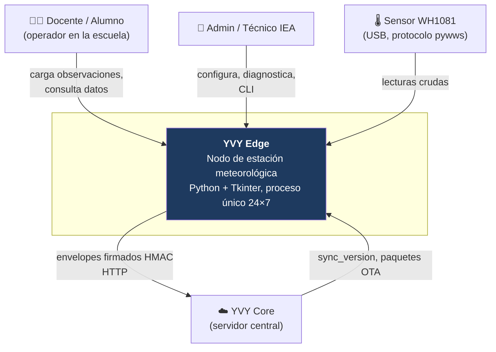
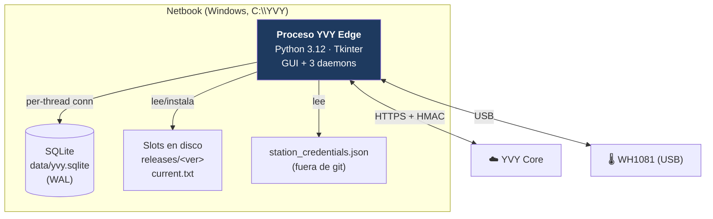
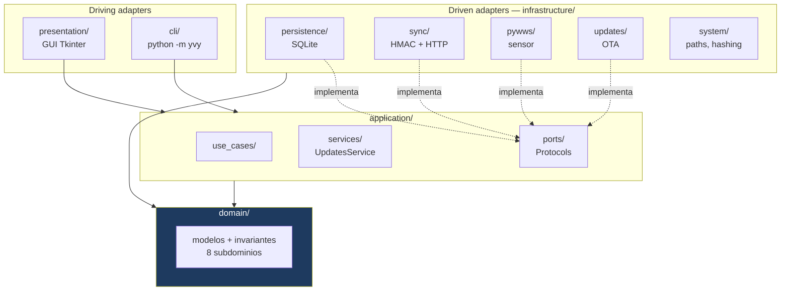
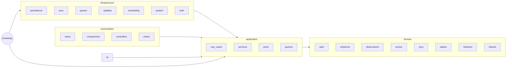

# 01 · Arquitectura General

**Propósito.** La forma del sistema: qué es YVY Edge, cómo está partido en capas
hexagonales, cómo fluyen las dependencias, y dónde vive cada cosa.

**Alcance.** Vista de conjunto. Los detalles de cada capa y subsistema están en
sus documentos; acá está el mapa que los conecta.

**Dependencias.** [02 · Convenciones e Invariantes](02_convenciones_e_invariantes.md).

---

## 1. Qué es YVY Edge

YVY Edge es el **nodo de estación meteorológica** que corre en una netbook en
cada escuela rural del programa (Misiones). Es una aplicación de escritorio
**Python + Tkinter**, de **proceso único**, que opera **24×7** y:

- captura lecturas de un sensor **WH1081** por USB (vía pywws),
- las valida, persiste y las presenta a docentes y alumnos,
- registra observaciones empíricas cargadas por personas,
- sincroniza los datos hacia el servidor central **YVY Core** por HTTP con firma
  HMAC,
- se actualiza sola por un canal **OTA** basado en slots.

Arquitectura **hexagonal / DDD**. Sin framework web, sin servidor de aplicación:
un ejecutable que arranca, cablea sus dependencias una vez, y levanta la GUI más
tres hilos daemon.

---

## 2. Contexto del sistema (C4 · nivel 1)

**Actores e integraciones:**

| Externo | Relación |
|---|---|
| Docente / Alumno | Operan la GUI: cargan observaciones empíricas, ven el dashboard. |
| Admin / Técnico IEA | Onboarding, configuración de sync, diagnóstico por CLI, recuperación de emergencia. |
| Sensor WH1081 | Fuente de lecturas. Buffer circular de ~14 días; se lee en modo *live* y *catchup*. |
| YVY Core | Destino de la sincronización y origen de los paquetes OTA. La relación es **pull firmado**: Edge inicia siempre. |

---

## 3. Contenedores (C4 · nivel 2)

YVY Edge es un **monolito de proceso único**. El nivel de contenedor de C4 es,
por eso, deliberadamente delgado: no hay servicios separados: hay **un proceso**,
su **base local** y el **filesystem de slots**. Los daemons son *hilos* del mismo
proceso, no contenedores (se ven en [07 · Runtime](07_runtime_bootstrap_ciclo_de_vida.md)).

---

## 4. Componentes: las 5 capas (C4 · nivel 3)

| Capa | Paquete | Responsabilidad | Documento |
|---|---|---|---|
| **Domain** | `domain/` | Reglas de negocio y de gobernanza, modelos, invariantes. Sin I/O. | [03](03_domain.md) |
| **Application** | `application/` | Casos de uso, servicios, puertos. Orquesta el dominio; no conoce detalles técnicos. | [04](04_application.md) |
| **Infrastructure** | `infrastructure/` | Adaptadores driven: SQLite, HTTP+HMAC, pywws, OTA, utilidades de sistema. | [05](05_infrastructure.md) |
| **Presentation** | `presentation/` | Driving adapter GUI: views, components, controllers, charts. | [06](06_presentation_cli.md) |
| **CLI** | `cli/` | Driving adapter de línea de comandos: diagnóstico y operación. | [06](06_presentation_cli.md) |

Fuera de las capas, dos piezas de cableado: [`config/`](../../src/yvy/config/)
(rutas y constantes) y [`bootstrap.py`](../../src/yvy/bootstrap.py) (el
Composition Root).

---

## 5. Mapa de paquetes

**Subdominios** (`domain/`): 8 — auth, empirical, observatorio, retention,
sensor, station, sync, shared. Detalle en [03](03_domain.md).

---

## 6. El Composition Root en una vista

Todo lo de arriba se conecta en **un solo lugar**, al arrancar.
[`build_core_dependencies(root)`](../../src/yvy/bootstrap.py) construye la
infraestructura y la congela en un `CoreDependencies` (dataclass inmutable, ~13
dependencias: la factory SQLite, los 8 repositorios, el reloj, el
`UpdatesService`, el `station_uuid`). Los driving adapters (GUI, CLI) reciben ese
objeto y **nunca** construyen infraestructura por su cuenta (INV-CR-2).

Detalle y diagrama de wiring en [07 · Runtime](07_runtime_bootstrap_ciclo_de_vida.md).

---

## 7. Decisiones arquitectónicas actuales

| Decisión | Estado hoy | Por qué |
|---|---|---|
| Hexagonal / puertos como Protocols | Adoptada en las 5 capas | Testeo de `application` sin I/O; dominio libre de detalles. |
| Composition Root único y protegido | `bootstrap.py`, con gate AST | Evita la clase de bug "fix aplicado en un sitio de construcción y no en otro". |
| Proceso único con 3 daemons | GUI + SensorCollector + SyncAgent + UpdateChecker | Simplicidad operativa en netbooks sin técnico en sitio. |
| SQLite local, per-thread | `SQLiteConnectionFactory` | Cero dependencias de servidor; robusto ante cortes. |
| OTA por slots | `CODE_ROOT`/`STABLE_ROOT` | Update atómico con rollback; datos intactos entre versiones. |
| Sync pull firmado | Edge inicia, HMAC-SHA256 | El nodo detrás de NAT no necesita puerto abierto; autenticidad verificable. |

---

## 8. Invariantes (de este documento)

- **La regla de dependencia** (§1 de [02](02_convenciones_e_invariantes.md)) es la
  invariante estructural raíz: todo lo demás se apoya en ella.
- **Un solo Composition Root** (INV-CR-1).
- **Un solo proceso**: no hay estado compartido entre procesos; la concurrencia
  es *intra*-proceso (hilos) y se gobierna con el contrato de threading de SQLite.

---

## 9. Puntos de extensión

- **Nuevo subdominio:** se agrega bajo `domain/`, con sus use cases en
  `application/` y su adaptador en `infrastructure/`. La GUI/CLI lo consumen vía
  el Composition Root.
- **Nuevo driving adapter** (p. ej. el servidor LAN embebido evaluado en su
  momento): se suma como par de `presentation`/`cli`, consumiendo `application`
  — nunca `infrastructure` directo.
- **Nuevo puerto:** se declara en `application` (o angosto junto al consumidor) y
  se implementa en `infrastructure`. El Composition Root lo cablea.

---

## 10. Reglas que no se rompen

Las de [02](02_convenciones_e_invariantes.md), en especial DEP-1..4 (dirección de
dependencias) e INV-CR-2 (nadie construye infraestructura fuera del root). Son la
base sobre la que se sostiene todo este documento.
