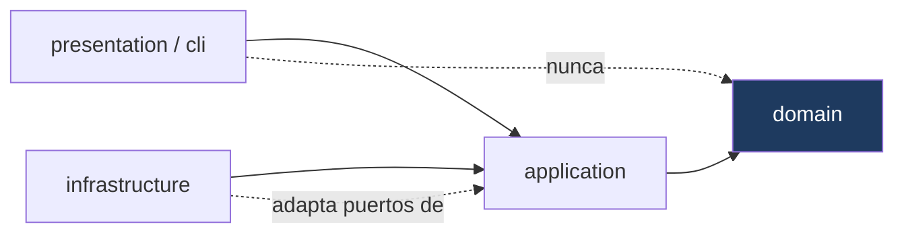

# 02 · Convenciones e Invariantes

**Propósito.** Las reglas que el sistema garantiza y que **no se rompen**. Es el
vocabulario común del resto de la Arquitectura de Referencia: los demás
documentos las nombran, acá se definen una sola vez.

**Alcance.** Reglas transversales a todas las capas. No describe ningún
subsistema en particular; cada documento de subsistema añade sus invariantes
locales y referencia las de acá.

**Dependencias.** Ninguna. Este es el primer documento a leer.

Una **invariante** es una propiedad que el sistema mantiene siempre; violarla es
un bug, no una variante de estilo. Muchas están **verificadas mecánicamente** por
los gates de CI (ver [12 · Calidad](12_calidad_testing_observabilidad.md)); las
que no, son contrato humano y se marcan como tales.

---

## 1. La regla de dependencia (hexagonal)

Las dependencias apuntan **hacia adentro**. El dominio no sabe que existe el
mundo exterior.

| Regla | Enunciado | Verificación |
|---|---|---|
| **DEP-1** | `domain/` no importa ninguna otra capa. Sólo stdlib. | Revisión + `domain` en el gate mypy strict |
| **DEP-2** | `application/` importa `domain`, nunca `infrastructure` ni `presentation`. Depende de infraestructura **sólo a través de Protocols** que él mismo define. | Revisión |
| **DEP-3** | `infrastructure/` **no importa `presentation` ni `tkinter`.** | Gate AST, regla B |
| **DEP-4** | `presentation/` y `cli/` son *driving adapters*: consumen `application` y `domain`, y reciben todo lo demás inyectado desde el Composition Root. | Revisión |

**Por qué importa.** La inversión de dependencias es lo que permite testear
`application/` sin base ni red, y lo que mantiene el dominio (las reglas del
negocio meteorológico y de gobernanza) libre de detalles de Tkinter, SQLite o
HTTP.

---

## 2. Puertos y adaptadores

- **INV-PORT-1.** Todo cruce de `application` hacia el exterior pasa por un
  **Protocol** (structural typing, sin herencia). Los puertos "grandes" viven en
  [`application/ports/`](../../src/yvy/application/ports/); los puertos angostos,
  de un solo método, se declaran **junto a su consumidor** (p. ej.
  `SyncVersionReader` en `sync_agent.py`, `_Clock` en `catchup_source.py`).
- **INV-PORT-2.** Un puerto declara **lo mínimo que su consumidor usa**, no la
  interfaz completa del adaptador. Un consumidor que sólo lee un entero declara
  un puerto de un método, no todo `AppConfigRepository`.
- **INV-PORT-3.** Los adaptadores concretos satisfacen los puertos **por
  estructura**: no heredan del Protocol. Cambiar un adaptador no toca al puerto.

---

## 3. Composition Root

- **INV-CR-1.** Existe **un único** lugar donde se construye la infraestructura:
  [`bootstrap.py`](../../src/yvy/bootstrap.py) →
  `build_core_dependencies(root)` → `CoreDependencies` (frozen dataclass). Ver
  [07 · Runtime](07_runtime_bootstrap_ciclo_de_vida.md).
- **INV-CR-2.** **Ningún frente construye infraestructura en runtime.** Ni la
  GUI, ni el CLI, ni los daemons instancian factories, installers o clientes
  HTTP por su cuenta: los reciben del Composition Root.
- **INV-CR-3.** En particular, la infraestructura del subsistema Updates
  (`UpdateInstaller`, `ReleaseRetention`, `UpdateDownloader`) se construye
  **sólo** en el Composition Root. *Verificado por el gate AST, regla A.*
- **Excepción documentada:** el CLI abre bases arbitrarias con `--db`
  (`bootstrap.py` y `__main__.py` son los únicos sitios autorizados a construir
  un `SQLiteConnectionFactory` fuera del root).

---

## 4. Las dos raíces: `CODE_ROOT` vs `STABLE_ROOT`

La invariante que más caro cuesta romper. Definida en
[`config/paths.py`](../../src/yvy/config/paths.py).

| Raíz | Qué cuelga | Ubicación en la flota |
|---|---|---|
| **`CODE_ROOT`** | Código, `assets/`, `resources/`, `migrations/`, `deploy/`. Lo que se versiona y **viaja con cada OTA**. | `C:\YVY\releases\<ver>` (el *slot*) |
| **`STABLE_ROOT`** | `data/`, la base SQLite, `logs/`, `exports/`, credenciales. Lo que **sobrevive a los updates**. | `C:\YVY` (persistente) |

- **INV-PATH-1.** Los datos persistentes cuelgan **siempre** de `STABLE_ROOT`,
  nunca de `CODE_ROOT`. `resolve_stable_root(CODE_ROOT)` deriva la raíz estable
  aunque el proceso corra desde un slot.
- **INV-PATH-2.** Confundirlas hace que, tras un OTA, el código apunte a una base
  vacía dentro del slot. Es la clase de bug de la pérdida de datos post-OTA.

Detalle en [10 · OTA](10_ota_updates.md) y [13 · Deployment](13_configuracion_deployment.md).

---

## 5. Persistencia y threading

Definido por `SQLiteConnectionFactory`. Detalle en
[08 · Adquisición y Persistencia](08_adquisicion_y_persistencia.md).

- **INV-DB-1.** Cada hilo usa su **propia** conexión SQLite (`threading.local()`,
  `check_same_thread=True`). Una conexión **no** cruza hilos.
- **INV-DB-2.** `SQLiteConnectionFactory` es el **único** contrato de
  construcción de conexiones para todos los repositorios. Un repo no abre su
  propia conexión.
- **INV-DB-3.** WAL activo, `busy_timeout=5000`. Escrituras que deben ser
  atómicas usan `BEGIN IMMEDIATE`.

---

## 6. Tiempo y formato-contrato

- **INV-TIME-1.** El formato ISO-ms-Z (`YYYY-MM-DDTHH:MM:SS.sssZ`) se produce
  **sólo** en [`domain/shared/time_utils.py`](../../src/yvy/domain/shared/time_utils.py)
  vía `iso_ms_z()`. Es un **formato-contrato**: aparece en `sent_at_utc`, uno de
  los campos firmados hacia Core, y un byte de diferencia invalida la firma HMAC.
  *Verificado por el gate AST, regla C.*
- **INV-TIME-2.** `iso_ms_z()` **exige** un datetime *timezone-aware*. Un naive
  es un bug aguas arriba y se rechaza con excepción, no se corrige en silencio.
- **INV-TIME-3.** Todo timestamp que se persiste o se transmite está en **UTC**.
  La conversión a la zona local (`America/Argentina/Cordoba`) es responsabilidad
  **exclusiva de la capa de presentación**, al mostrar.

---

## 7. Seguridad (resumen; detalle en [11 · Seguridad](11_seguridad.md))

- **INV-SEC-1.** `data/station_credentials.json` y la base (`*.sqlite`,
  `-wal`, `-shm`) **nunca** se commitean.
- **INV-SEC-2.** La sincronización hacia Core firma con **HMAC-SHA256** sobre el
  **JSON canónico del envelope completo sin el campo `signature`**. El Edge
  *genera* firmas, nunca las compara.
- **INV-SEC-3.** **Nunca** hacer *Replace Driver* (Zadig) sobre un dispositivo
  que no tenga `VID=0x1941 PID=0x8021`: podría ser un teclado o mouse. El WH1081
  es el único objetivo válido.

---

## 8. Lenguaje contractual del dominio

- **INV-LANG-1.** El sistema habla de **"probable helada"**, nunca de "helada
  confirmada". Es una restricción contractual del proyecto (responsabilidad ante
  las escuelas y el IEA): YVY estima, no certifica. Aplica a UI, mensajes, y
  cualquier salida hacia el usuario.

---

## 9. Theming

Detalle en [06 · Presentation & CLI](06_presentation_cli.md).

- **INV-UI-1.** Todo widget Tk clásico se construye con `bg` explícito. Un widget
  sin `bg` nace con el gris del sistema, que el recoloreo de tema oscuro no
  reconoce, y queda ilegible. *Verificado por el gate AST, regla D.*
- **INV-UI-2.** `recolor()` recupera un `fg` faltante (lo trata como el color de
  texto del tema); un `bg` faltante es **irrecuperable** y por eso la regla exige
  `bg` y no `fg`.

---

## 10. Manejo de errores y observabilidad

- **INV-ERR-1.** No hay `except Exception: pass` mudos en rutas con efecto
  observable: todo swallow de excepción **loguea** con contexto. La única
  excepción documentada es el *hot loop* por-widget del `theme_manager`, que
  spamearía el log.
- **INV-ERR-2.** Un callback diferido (Tk `after`, lambda en un hilo) que captura
  una variable de un `except ... as exc` la **liga explícitamente**
  (`lambda exc=exc: ...`): Python borra el nombre al salir del bloque, y el
  callback correría con `NameError` **dentro del handler de error**.

---

## 11. Convenciones de código

- **INV-CODE-1.** Los tres gates de CI son **bloqueantes**: `ruff` (lint +
  formato), `arch` (reglas AST del proyecto), `mypy` (contratos de tipos sobre
  `domain`+`application`+`infrastructure`+`cli`). Ninguno se saltea.
- **INV-CODE-2.** Toda supresión (`# type: ignore`, `# noqa`) lleva **código de
  error específico** y comentario de motivo. *Verificado por ruff (PGH).*
- **INV-CODE-3.** El alcance de los gates **sólo crece**. Bajar un nivel o sacar
  un paquete requiere justificación documentada, no sólo un cambio de config.

---

## Reglas que no se rompen (síntesis)

El destilado operativo, para tener a mano:

1. Las dependencias apuntan hacia adentro (DEP-1..4).
2. La infraestructura se construye sólo en el Composition Root (INV-CR-2/3).
3. Los datos cuelgan de `STABLE_ROOT`, el código de `CODE_ROOT` (INV-PATH-1).
4. Una conexión SQLite por hilo, vía la factory (INV-DB-1/2).
5. El formato-contrato de timestamps se produce en un solo lugar, en UTC (INV-TIME-1/3).
6. Credenciales y base nunca se commitean; Replace-Driver sólo sobre VID/PID del WH1081 (INV-SEC-1/3).
7. "Probable helada", nunca confirmada (INV-LANG-1).
8. Widgets Tk con `bg` explícito (INV-UI-1).
9. Sin swallows mudos; ligar `exc` en callbacks diferidos (INV-ERR-1/2).
10. Los gates son bloqueantes y su alcance sólo crece (INV-CODE-1/3).
