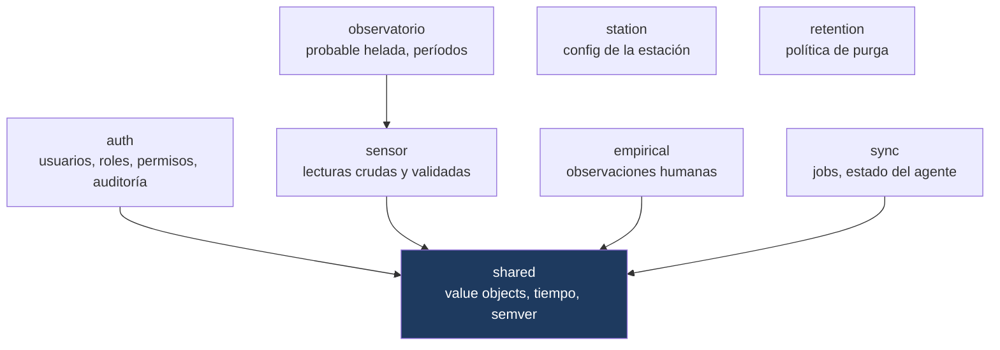

# 03 · Domain

**Propósito.** El corazón del sistema: las reglas de negocio y de gobernanza, los
modelos, los invariantes de dominio. Sin I/O, sin frameworks.

**Alcance.** El paquete [`domain/`](../../src/yvy/domain/). No cubre cómo se
persisten los modelos (eso es [08](08_adquisicion_y_persistencia.md)) ni cómo se
orquestan (eso es [04](04_application.md)).

**Dependencias.** [01 · Arquitectura General](01_arquitectura_general.md),
[02 · Convenciones](02_convenciones_e_invariantes.md).

---

## 1. Regla de la capa

`domain/` **no importa ninguna otra capa**. Sólo stdlib (dataclasses, datetime,
enum, uuid, decimal). Es la única capa que compila y se testea completamente
aislada, y está bajo mypy **strict**.

Los modelos son **dataclasses `frozen=True, slots=True`**: inmutables, con
validación en `__post_init__`. Un modelo inválido no se puede construir.

---

## 2. Los 8 subdominios

| Subdominio | Modelos / conceptos clave | Responsabilidad |
|---|---|---|
| **shared** | `StationUUID`, `EventID`, `CanonicalTimestamp`, `Version`, `iso_ms_z()` | Value objects y utilidades transversales. Base de los demás. |
| **auth** | `User`, `AuditLogEntry`, `Role`, `Permissions` | Identidad, jerarquía de roles, permisos, registro de auditoría. |
| **sensor** | `RawPayload`, `SensorReading`, `EventID` | El dato del WH1081: crudo (como llegó) y validado. |
| **empirical** | `EmpiricalObservation`, `EmpiricalEvent` | Observaciones cargadas por personas (percepción, fenología, ganado). |
| **observatorio** | `FrostLevel`, `probable_frost_level()`, períodos nocturnos, rangos | Lógica del observatorio: **probable helada**, ventanas de noche, clamps de rango. |
| **sync** | `SyncJob`, `SyncAgentState`, `AgentState` | Unidad de sincronización y máquina de estados del agente. |
| **station** | `AppConfigReader` (puerto) | Contrato de lectura de configuración de la estación. |
| **retention** | `RetentionPolicy`, `RetentionResult` | Reglas de purga de datos viejos. |

---

## 3. Value objects (shared)

- **`StationUUID`** — envuelve un `UUID` con validación; identidad estable de la
  estación cross-instance.
- **`EventID`** — identificador único de una lectura/observación (UUID v5);
  clave de idempotencia en la sincronización.
- **`CanonicalTimestamp`** — timestamp canonicalizado a UTC. Producido por
  `canonicalize_to_minute_utc()` y `parse_pywws_ts()`.
- **`Version`** — tupla `(major, minor, patch)`; `parse_semver()`,
  `version_gte()`, `version_lte()`, con política de *unparseable* **explícita y
  obligatoria** por parámetro (`on_unparseable`).

**INV-DOM-1.** El semver se parsea en **un solo lugar**
([`shared/version.py`](../../src/yvy/domain/shared/version.py)); las políticas
opuestas (el installer "no bloquear", el pending "no descartar") se hacen visibles
por el argumento `on_unparseable`, no por implementaciones divergentes.

El formato-contrato de tiempo (`iso_ms_z`) se documenta como invariante en
[02 · §6](02_convenciones_e_invariantes.md).

---

## 4. auth: roles y permisos

Jerarquía: **`SUPERADMIN > ADMIN > PROFESOR > ALUMNO`** (`Role`, StrEnum).
`Permissions` deriva de un rol qué acciones están habilitadas; la GUI y los use
cases lo consultan.

- **INV-DOM-2.** `User.id` es `int | None`: `None` significa "no persistido aún".
  Un `User` sin id no puede ser autor de un registro (la precondición se hace
  explícita en la capa de aplicación, ver [04](04_application.md)).
- **`AuditLogEntry`** es el registro inmutable de una acción con efecto de
  gobernanza (login, cambio de usuario, creación de observación, rollback).

---

## 5. sensor: crudo vs validado

Dos modelos, deliberadamente separados:

- **`RawPayload`** — la lectura **tal como llegó** del WH1081. Se guarda íntegra
  antes de interpretarla: si la validación cambia, el crudo sigue ahí.
- **`SensorReading`** — la lectura **validada e interpretada** (unidades,
  rangos, `is_valid`).

**INV-DOM-3.** Una `SensorReading` con `is_valid=False` **no** prueba que se
capturó ese instante: es una lectura descartada, no un hueco cubierto. El
catchup y las agregaciones lo tienen en cuenta.

---

## 6. empirical: la voz humana

`EmpiricalObservation` (percepción del tiempo, estado del suelo, fenología,
ganado) y `EmpiricalEvent` (eventos puntuales: granizo, helada observada). Ambos
llevan `created_by_user_id: int` — su autor **persistido**.

- **INV-DOM-4.** Valores fuera de rango físico **nunca** se persisten como
  válidos; los `CHECK` del esquema y la validación de dominio los rechazan. Un
  campo crítico faltante sí es confirmable (no invalida la carga).

---

## 7. observatorio: probable helada

El subdominio con más lógica de negocio pura.

- `probable_frost_level(...) -> FrostLevel` estima el **nivel de probable
  helada** radiativa a partir de temperatura, humedad, viento y período nocturno.
- Períodos nocturnos, clamps de rango y detección viven acá, sin tocar I/O.

**INV-DOM-5 (contractual).** La salida es **"probable helada"**, nunca "helada
confirmada" (INV-LANG-1). El nombre del enum, los colores y los textos derivados
respetan esa restricción. Ver [11 · Seguridad](11_seguridad.md) para el porqué
contractual.

---

## 8. sync: unidad de trabajo y estado

- **`SyncJob`** — una unidad a sincronizar: `event_id` (idempotencia),
  `entity_type`, `payload`, estado. Es lo que el agente envuelve y firma.
- **`SyncAgentState`** / **`AgentState`** — la máquina de estados persistida del
  agente (`HEALTHY`, `DEGRADED`, `DISCONNECTED`, `AUTH_ERROR_LATCHED`,
  `CLOCK_ERROR_LATCHED`, `PAUSED`). Los estados *latcheados* requieren
  intervención manual (reinicio) para salir. Detalle en [09](09_sincronizacion.md).

---

## 9. Puertos que el dominio posee

El dominio define algunos Protocols de repositorio (`domain/*/repository.py`,
`domain/*/agent_state_repository.py`, `domain/station/repository.py`). Son
**contratos que la infraestructura satisface**, no implementaciones. El dominio
declara "necesito poder guardar un `SyncJob`"; `infrastructure/persistence` provee
el cómo.

---

## 10. Invariantes (síntesis)

- INV-DOM-1: semver en un solo lugar, política explícita por parámetro.
- INV-DOM-2: `User.id is None` ⇒ no persistido; no puede ser autor.
- INV-DOM-3: `SensorReading` inválida ≠ instante cubierto.
- INV-DOM-4: fuera de rango físico no se persiste como válido.
- INV-DOM-5: "probable helada", nunca confirmada.
- Todos los modelos son inmutables y se validan al construirse.

## 11. Puntos de extensión

- **Nuevo modelo:** dataclass frozen con validación en `__post_init__`, en su
  subdominio. Si necesita persistirse, declara su Protocol de repositorio acá y
  se implementa en infraestructura.
- **Nueva regla de observatorio:** función pura en `domain/observatorio/`,
  testeable sin I/O.

## 12. Reglas que no se rompen

- `domain/` no importa otras capas (DEP-1).
- Los modelos son inmutables y válidos por construcción.
- El lenguaje contractual ("probable helada") es parte del dominio, no cosmética
  de UI.
