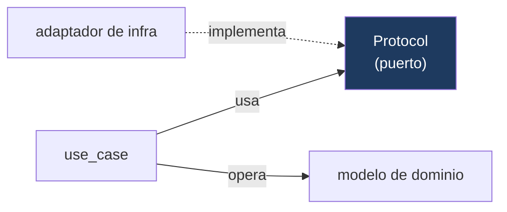

# 04 · Application

**Propósito.** La capa que orquesta el dominio para cumplir casos de uso, sin
conocer detalles técnicos. Define los **puertos** que la infraestructura
satisface.

**Alcance.** El paquete [`application/`](../../src/yvy/application/): `use_cases/`,
`services/`, `ports/`, `queries/`. No cubre cómo se implementan los puertos (eso
es [05](05_infrastructure.md)) ni los flujos runtime de sync/OTA (docs 09/10).

**Dependencias.** [03 · Domain](03_domain.md),
[02 · Convenciones](02_convenciones_e_invariantes.md).

---

## 1. Regla de la capa

`application/` importa `domain`, **nunca** `infrastructure` ni `presentation`.
Toda dependencia del exterior entra por un **Protocol** que esta capa define. Está
bajo mypy **strict**.

Un caso de uso recibe sus dependencias por constructor (puertos + repositorios) y
expone un método de ejecución. No abre bases, no arma HTTP, no toca Tk.

---

## 2. Estructura

| Sub-paquete | Contenido | Rol |
|---|---|---|
| `use_cases/` | admin, auth, empirical, sensor, retention, updates + top-level (`compute_derived`, `query_sensor_aggregated`) | Un caso de uso = una intención del sistema. |
| `services/` | `UpdatesService` | Servicio de aplicación de larga vida, construido una vez. |
| `ports/` | `CatchupSource`, `SensorSource`, `PasswordHasher`, `TimeProvider` | Puertos "grandes", reusados por varios use cases. |
| `queries/` | `unit_conversion` | Consultas/transformaciones puras de lectura. |

---

## 3. Catálogo de use cases

| Grupo | Use case | Qué hace |
|---|---|---|
| **auth** | `login`, `create_user`, `change_password`, `manage_user`, `complete_onboarding` | Identidad y ciclo de vida de usuarios; onboarding inicial de la estación. |
| **empirical** | `create_empirical_observation`, `create_empirical_event`, `list_get_observations` | Alta y consulta de observaciones humanas. |
| **sensor** | `capture_live_reading`, `run_catchup_recovery` | Captura en vivo y recuperación del buffer del WH1081. |
| **admin** | `export_data_csv`, `export_raw_csv`, `import_data_csv`, `list_audit_logs`, `update_retention_policy` | Operaciones de administración y gobernanza de datos. |
| **retention** | `run_retention_job` | Purga de datos viejos según política. |
| **updates** | `post_boot_check` (`RunPostBootCheckUseCase`) | Verificación de arranque post-instalación OTA. |
| **derivados** | `compute_derived`, `query_sensor_aggregated` | Indicadores derivados y agregaciones para el dashboard. |

---

## 4. Patrón: decisión pura + I/O separado

Los use cases y controllers separan **decidir** de **actuar**. La decisión es una
función pura testeable sin I/O; el efecto (persistir, mostrar) queda afuera.

**Precondiciones explícitas.** Cuando un tipo del dominio es más laxo que lo que
el caso de uso exige, la precondición se hace **explícita y ruidosa**, no se
castea. Ejemplo canónico
([`empirical/_actor.py`](../../src/yvy/application/use_cases/empirical/_actor.py)):

- `User.id` es `int | None` (INV-DOM-2), pero un registro empírico exige autor
  persistido. `require_persisted_actor_id(actor)` falla con excepción si el id es
  `None`, en vez de persistir un `0` silencioso.

**INV-APP-1.** Un caso de uso no repara datos inválidos en silencio: si una
precondición no se cumple, falla de forma visible.

---

## 5. Puertos (Protocols)

Los puertos "grandes" viven en [`application/ports/`](../../src/yvy/application/ports/):

| Puerto | Método(s) | Implementado por |
|---|---|---|
| `TimeProvider` | `now_utc()`, `now_local()` | `SystemClock` (infra/system) |
| `SensorSource` | `read_live()` | `PywwsLiveSource` (infra/pywws) |
| `CatchupSource` | `read_since(datetime)` | `PywwsCatchupSource` (infra/pywws) |
| `PasswordHasher` | `hash()`, `verify()` | `BcryptPasswordHasher` (infra/auth) |

Los puertos **angostos** (un método) se declaran junto a su consumidor, no acá
(INV-PORT-1). Los repositorios son Protocols del **dominio**
([03 · §9](03_domain.md)), no de esta capa.

---

## 6. `UpdatesService`: el punto único del subsistema Updates

[`services/updates_service.py`](../../src/yvy/application/services/updates_service.py)
es el servicio de aplicación central del OTA. Se construye **una vez** en el
Composition Root y es el **único** punto por el que la GUI y el CLI operan sobre
updates. Antes de existir, la orquestación de updates estaba repartida entre UI,
scripts y CLI, cada uno fabricando su infraestructura — la causa raíz de los
peores incidentes de campo.

Superficie (resumen): `get_status()`, `prevalidate()`, `request_install()`,
`download()`, `rollback()`, `mark_stable_manual()`, `evaluate_stable_promotion()`,
`get_releases_on_disk()`, flags de boot. Depende de puertos
(`AppConfigReaderPort`, `InstallerPort`, `RetentionPort`, `DownloaderPort`), no de
infraestructura concreta.

- **INV-APP-2.** Devuelve `OperationResult(ok, error)` en vez de `bool` pelado
  donde el operador necesita ver el motivo del fallo. Detalle del flujo en
  [10 · OTA](10_ota_updates.md).

---

## 7. Decisiones arquitectónicas actuales

| Decisión | Estado | Por qué |
|---|---|---|
| Puertos como Protocols, no ABCs | Adoptada | Structural typing; el adaptador no hereda del puerto. |
| Decisión pura separada del I/O | Adoptada en use cases y controllers | Se testea la lógica sin base ni red ni display. |
| `UpdatesService` único | Adoptada, construido en bootstrap | Elimina la dispersión de la orquestación de updates. |
| Precondiciones explícitas sobre tipos laxos del dominio | Adoptada (`_actor.py`) | Evita corrupción silenciosa; el bug se ve. |

---

## 8. Invariantes

- INV-APP-1: sin reparación silenciosa de precondiciones.
- INV-APP-2: `OperationResult` donde el error importa al operador.
- La capa no importa infraestructura (DEP-2); todo cruce es por Protocol.

## 9. Puntos de extensión

- **Nuevo caso de uso:** clase con dependencias inyectadas por constructor
  (puertos + repos del dominio), método de ejecución, testeable con fakes.
- **Nueva dependencia externa:** se declara un Protocol (grande en `ports/`,
  angosto junto al consumidor) y se implementa en infraestructura.

## 10. Reglas que no se rompen

- `application/` no importa `infrastructure` ni `presentation` (DEP-2).
- La infraestructura de updates se construye sólo en el Composition Root; el
  `UpdatesService` es el único frente de operación (INV-CR-3, INV-APP-2).
