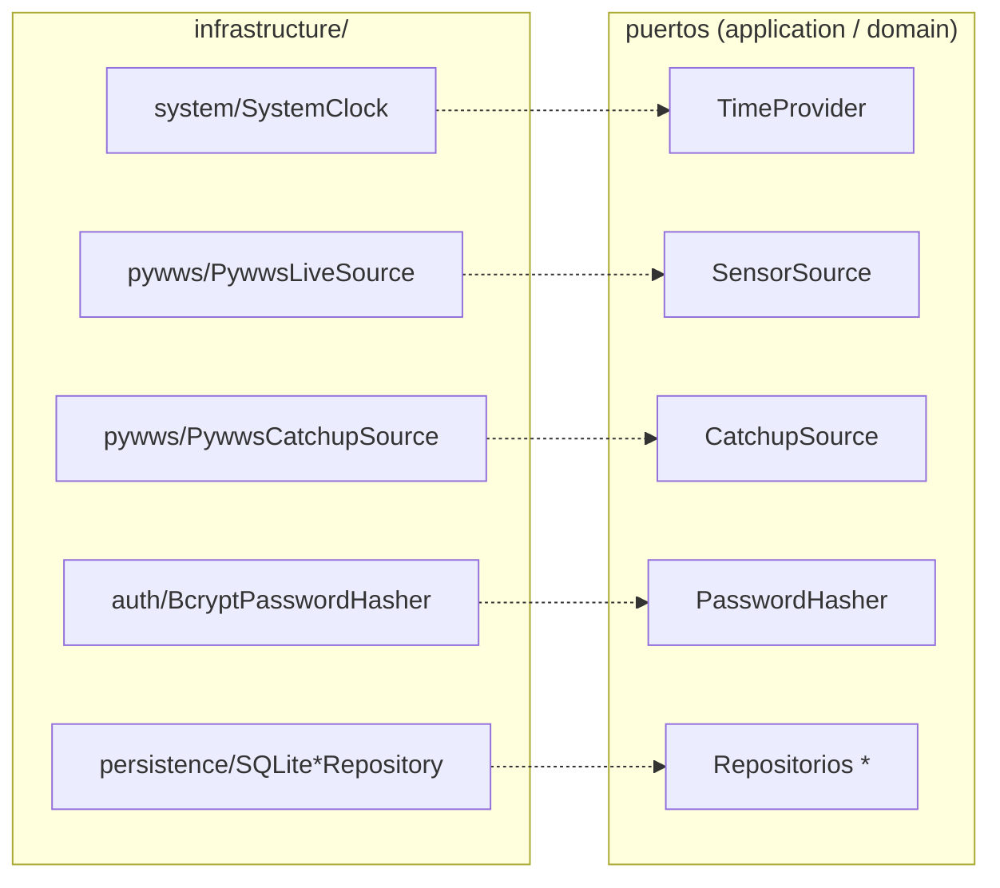

# 05 · Infrastructure

**Propósito.** Catálogo de los **driven adapters**: las implementaciones
concretas que satisfacen los puertos de la aplicación y el dominio. Es la capa
que habla con SQLite, USB, HTTP, el filesystem y el reloj del SO.

**Alcance.** El paquete [`infrastructure/`](../../src/yvy/infrastructure/). Este
documento es el **mapa de adaptadores**; los flujos profundos de cada subsistema
tienen su propio documento y se enlazan desde acá.

**Dependencias.** [04 · Application](04_application.md),
[02 · Convenciones](02_convenciones_e_invariantes.md).

---

## 1. Regla de la capa

`infrastructure/` **no importa `presentation` ni `tkinter`** (DEP-3, *gate AST
regla B*). Depende de `application` y `domain` para satisfacer sus puertos.
Bajo mypy **strict-lite** (los puertos quedan tipados; las libs externas sin
stubs no fuerzan genéricos exhaustivos).

Cada adaptador satisface un puerto **por estructura** (no hereda de él).

---

## 2. Mapa de adaptadores → puertos

| Sub-paquete | Adaptadores | Puerto que satisface | Documento profundo |
|---|---|---|---|
| `persistence/` | `SQLiteConnectionFactory` + 8 repositorios + `migrations` | Repositorios del dominio | [08](08_adquisicion_y_persistencia.md) |
| `sync/` | `sync_agent`, `http_client`, `envelope_builder`, `hmac_signer`, `canonical_json`, `clock_offset`, `update_checker_daemon`, `update_downloader` | (subsistema Sync) | [09](09_sincronizacion.md) |
| `pywws/` | `PywwsLiveSource`, `PywwsCatchupSource`, `weatherstation` | `SensorSource`, `CatchupSource` | [08](08_adquisicion_y_persistencia.md) |
| `updates/` | `installer` (`UpdateInstaller`), `retention` (`ReleaseRetention`) | (subsistema OTA) | [10](10_ota_updates.md) |
| `scheduling/` | `sensor_collector` (`SensorCollectorDaemon`) | — (daemon) | [07](07_runtime_bootstrap_ciclo_de_vida.md) / [08](08_adquisicion_y_persistencia.md) |
| `system/` | `paths`, `hashing`, `clock`, `hardware_fingerprint` | `TimeProvider`, utilidades | este doc, §4 |
| `auth/` | `BcryptPasswordHasher` | `PasswordHasher` | [11](11_seguridad.md) |
| `help/` | `HelpRepository` | contenido de ayuda | [06](06_presentation_cli.md) |

---

## 3. persistence: el contrato de construcción

`SQLiteConnectionFactory`
([`connection.py`](../../src/yvy/infrastructure/persistence/connection.py)) es el
**único** contrato de construcción de conexiones (INV-DB-2). Cachea **una
conexión por hilo** (`threading.local()`, `check_same_thread=True`), con **WAL**,
`synchronous=NORMAL` y `busy_timeout=5000`.

Los 8 repositorios (`SQLiteUserRepository`, `...AuditLog...`, `...Sensor...`,
`...Sync...`, `...SyncAgentState...`, `...Empirical...`, `AppConfigRepository`,
`AppMetricsRepository`) reciben la factory y **no** abren conexiones por su
cuenta. Detalle del modelo de datos y el threading en
[08](08_adquisicion_y_persistencia.md).

---

## 4. system: utilidades de plataforma

| Módulo | Qué provee |
|---|---|
| [`paths.py`](../../src/yvy/infrastructure/system/paths.py) | `resolve_stable_root(code_root)` — deriva `STABLE_ROOT` aunque el proceso corra desde un slot. Base de INV-PATH-1. |
| [`hashing.py`](../../src/yvy/infrastructure/system/hashing.py) | `sha256_file()`, `verify_sha256_file()` — verificación de integridad (case-insensitive, un solo hasher canónico). |
| `clock.py` | `SystemClock` — implementa `TimeProvider` (`now_utc`/`now_local`). |
| `hardware_fingerprint.py` | Huella de hardware del nodo, para identidad/diagnóstico. |

**INV-INFRA-1.** El hash de archivo se calcula y compara en **un solo lugar**;
la comparación es case-insensitive (un hex en mayúsculas de Core no debe fallar
la verificación del paquete OTA).

---

## 5. Los daemons viven acá

Tres adaptadores son *hilos de larga vida*, no simples implementaciones de
puerto: `SensorCollectorDaemon` (`scheduling/`), `SyncAgentDaemon` y
`UpdateCheckerDaemon` (`sync/`). Se construyen en el arranque y su ciclo de vida
se gobierna desde [07 · Runtime](07_runtime_bootstrap_ciclo_de_vida.md).

---

## 6. Decisiones arquitectónicas actuales

| Decisión | Estado | Por qué |
|---|---|---|
| SQLite con factory per-thread | `SQLiteConnectionFactory` | Concurrencia intra-proceso segura sin servidor. |
| Puertos angostos locales para deps de infra | `SyncVersionReader`, `_Clock` | El adaptador declara lo mínimo que usa, no toda la interfaz. |
| pywws envuelto detrás de puertos | `SensorSource`/`CatchupSource` | El dominio y la aplicación no conocen el protocolo del WH1081. |
| Un solo hasher / un solo `resolve_stable_root` | `system/` | Utilidades canónicas: sin divergencia entre implementaciones. |

---

## 7. Invariantes

- DEP-3: no importa `presentation` ni `tkinter` (gate AST regla B).
- INV-DB-1/2: una conexión por hilo, vía la factory.
- INV-INFRA-1: hash de archivo canónico, comparación case-insensitive.
- La infraestructura de updates se construye sólo en el Composition Root
  (INV-CR-3, gate AST regla A).

## 8. Puntos de extensión

- **Nuevo adaptador:** implementa un puerto existente (structural) o uno nuevo
  declarado en `application`/`domain`. Se cablea en el Composition Root.
- **Nuevo repositorio:** recibe `SQLiteConnectionFactory`; nunca abre su propia
  conexión. Si necesita esquema nuevo, agrega una migración
  ([08](08_adquisicion_y_persistencia.md)).

## 9. Reglas que no se rompen

- Sin imports de `presentation`/`tkinter` (DEP-3).
- Toda conexión SQLite nace de la factory (INV-DB-2).
- La infraestructura de updates sólo se construye en `bootstrap.py`.
