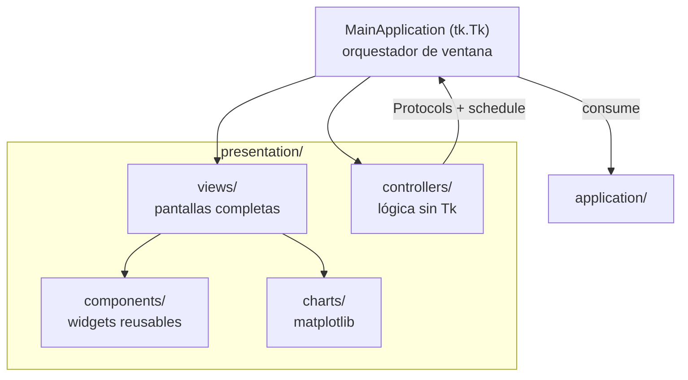
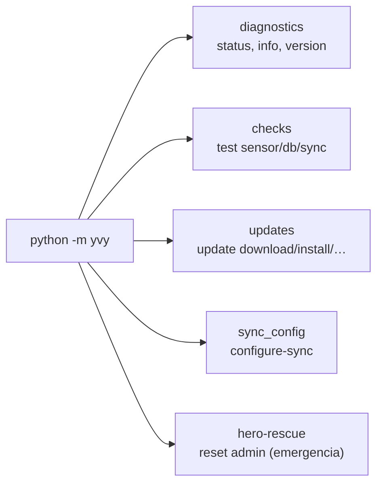

# 06 · Presentation & CLI

**Propósito.** Los dos **driving adapters** del sistema: la GUI Tkinter que usan
docentes y admins, y el CLI (`python -m yvy`) para operación y diagnóstico. Ambos
consumen la aplicación; ninguno construye infraestructura.

**Alcance.** [`presentation/`](../../src/yvy/presentation/) y
[`cli/`](../../src/yvy/cli/). No cubre el arranque ni el ciclo de vida de la
ventana (eso es [07](07_runtime_bootstrap_ciclo_de_vida.md)).

**Dependencias.** [04 · Application](04_application.md),
[02 · Convenciones](02_convenciones_e_invariantes.md).

---

## 1. Regla de la capa

`presentation/` y `cli/` son *driving adapters*: consumen `application` y
`domain`, y reciben todo lo demás **inyectado** desde el Composition Root
(INV-CR-2). No abren bases, no arman HTTP.

> **Nota de calidad.** `presentation/` está fuera del gate mypy (su valor está en
> la frontera con `application`, que sí está en strict). Documentar ≠ gatear:
> esta capa es parte de la arquitectura y se describe tal cual es. Ver
> [12 · Calidad · §5](12_calidad_testing_observabilidad.md).

---

## 2. GUI: anatomía

| Sub-paquete | Contenido | Rol |
|---|---|---|
| `views/` | `login`, `dashboard_admin`, `sync_status`, `help`, + `admin/`, `empirical/`, `observatorio/`, `onboarding/` | Pantallas completas por sección. |
| `components/` | `Header`, `Sidebar`, `StatusIndicator`, modales, carrusel, pizarra, chart widget (~17) | Widgets reusables entre views. |
| `controllers/` | `auth`, `sync`, `empirical`, `users_admin`, `header`, `update_flow`, `catchup` | Lógica de presentación **sin `tkinter`**. |
| `charts/` | wrappers matplotlib (~9) | Gráficos del dashboard. |

`MainApplication` (`app.py`) es la ventana raíz: mantiene el estado de sesión y
navegación, y delega la lógica a los controllers. Su ciclo de vida (login → main
→ wizard) está en [07](07_runtime_bootstrap_ciclo_de_vida.md).

---

## 3. Controllers: lógica de presentación sin Tk

El patrón central de esta capa. Un controller **no importa `tkinter`**: su
interfaz con la ventana es angosta a propósito —uno o dos `Protocol` y un
`schedule` inyectado— de modo que la lógica se testea **sin display**.

- **Decisión pura separada del pintado.** Ejemplo:
  `update_flow_controller` decide *qué* mensaje mostrar tras una instalación
  (función pura, cubierta por tests); `app.py` sólo lo *pinta*. Igual el
  `catchup_controller` (¿hay hueco que recuperar?) y el `header_controller` (los
  semáforos de estado).
- **`schedule` inyectado** en vez de `self.after` directo: el controller agenda
  trabajo sin tocar el event loop, y los tests le pasan un scheduler falso.

**INV-PRES-1.** Un controller de presentación no importa `tkinter` ni construye
widgets: recibe un `schedule`/callbacks y opera sobre puertos.

**INV-PRES-2.** El estado de los semáforos del header es un `Literal` cerrado
(`State = Literal["ok","warning","error","neutral"]`), compartido entre el
controller y el widget: un color inválido es error de tipo, no un fallo en runtime.

---

## 4. Theming

El tema (claro/oscuro) se aplica **recoloreando el árbol de widgets** al vuelo
(`theme_manager.recolor()`), no por hoja de estilos.

- **INV-UI-1** (de [02](02_convenciones_e_invariantes.md)): todo widget Tk
  clásico se construye con `bg` explícito. Un widget sin `bg` nace con el gris
  del sistema, que `recolor()` no reconoce, y queda ilegible en tema oscuro.
  *Verificado por el gate AST, regla D.*
- `recolor()` **sí** recupera un `fg` faltante (lo trata como el color de texto
  del tema) pero **no** puede recuperar un `bg` faltante — de ahí que la regla
  exija `bg` y no `fg`.
- La zona horaria local se aplica **sólo acá**, al mostrar (INV-TIME-3): el resto
  del sistema trabaja en UTC.

---

## 5. Zona horaria y presentación

Toda conversión UTC → hora local (`America/Argentina/Cordoba`) ocurre en esta
capa, al renderizar. Los modelos, la persistencia y la sincronización nunca ven
hora local. Es la contracara de INV-TIME-3.

---

## 6. CLI: operación y diagnóstico

`python -m yvy` ([`cli/__main__.py`](../../src/yvy/cli/__main__.py)) es el
segundo driving adapter. Un subcomando devuelve exit 0 si todo OK, 1 si hay
problema — apto para scripts y monitoreo.

| Handler | Comandos |
|---|---|
| `diagnostics` | `status`, `info`, `version`, `check-updates` |
| `checks` | `test sensor`, `test db`, `test sync` |
| `updates` | `update status/download/install/mark-stable`, `rollback` |
| `sync_config` | `configure-sync` |
| (`__main__`) | `migrate`, `retention`, `hero-rescue` |

- **`hero-rescue`** — reset de password admin/superadmin de emergencia (bypass de
  auth), el único camino cuando la UI bloquea el acceso. Es alcanzable por
  `python -m yvy` (los `.bat` de la flota usan ese entry point).
- **Excepción autorizada:** el CLI puede abrir bases arbitrarias con `--db`, uno
  de los dos únicos sitios que construyen un `SQLiteConnectionFactory` fuera del
  Composition Root (INV-CR-3).

Guía de operador: [`yvy_CLI_GUIA.md`](../yvy_CLI_GUIA.md).

---

## 7. Decisiones arquitectónicas actuales

| Decisión | Estado | Por qué |
|---|---|---|
| Controllers sin `tkinter` | Adoptada (7 controllers) | Lógica de presentación testeable sin display. |
| `schedule` inyectado | Adoptada | El controller no toca el event loop; tests con scheduler falso. |
| Theming por recoloreo de árbol | `theme_manager.recolor()` | Tema claro/oscuro sin duplicar estilos por widget. |
| CLI como segundo driving adapter | `python -m yvy` | Operación y diagnóstico sin GUI; scripts y monitoreo. |
| Hora local sólo en presentación | Adoptada | UTC extremo a extremo; conversión al mostrar. |

---

## 8. Invariantes

- INV-PRES-1: controllers no importan `tkinter`.
- INV-PRES-2: estado de semáforo como `Literal` cerrado.
- INV-UI-1/2: `bg` explícito en widgets Tk; `recolor` recupera `fg`, no `bg`.
- INV-TIME-3: conversión a hora local sólo en esta capa.

## 9. Puntos de extensión

- **Nueva pantalla:** una view en `views/`, reusando `components/`; su lógica no
  trivial va a un controller sin `tkinter`.
- **Nuevo comando CLI:** un handler en `cli/handlers/`, registrado en
  `__main__.py`, devolviendo exit code claro.
- **Nuevo driving adapter** (ej. web LAN): consume `application` vía el
  Composition Root, nunca `infrastructure` directo.

## 10. Reglas que no se rompen

- Los driving adapters no construyen infraestructura (INV-CR-2).
- Controllers sin `tkinter` (INV-PRES-1).
- Widgets con `bg` explícito (INV-UI-1).
- Hora local sólo al mostrar (INV-TIME-3).
