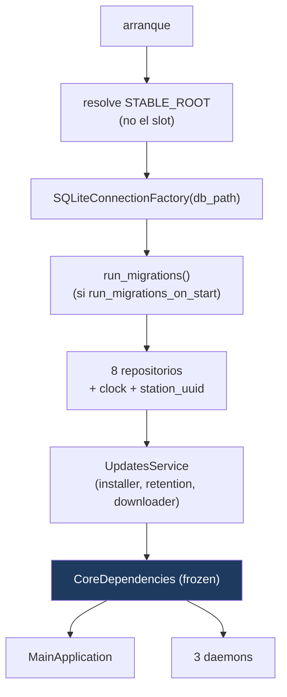
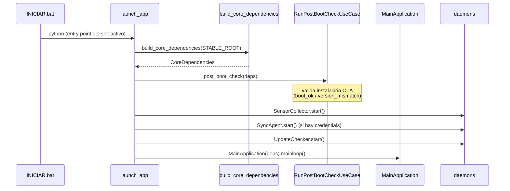
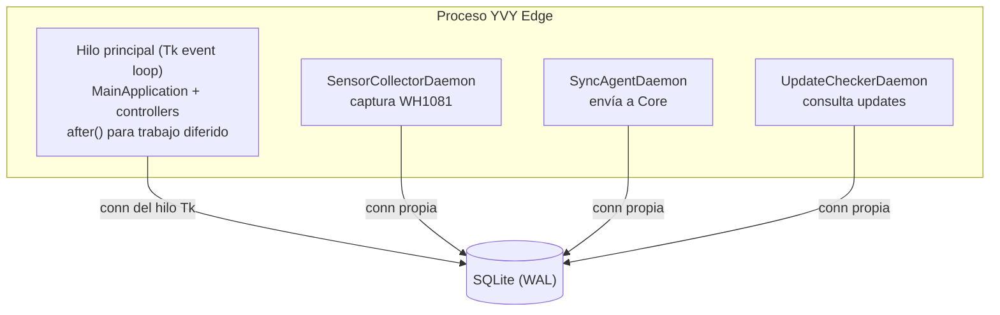
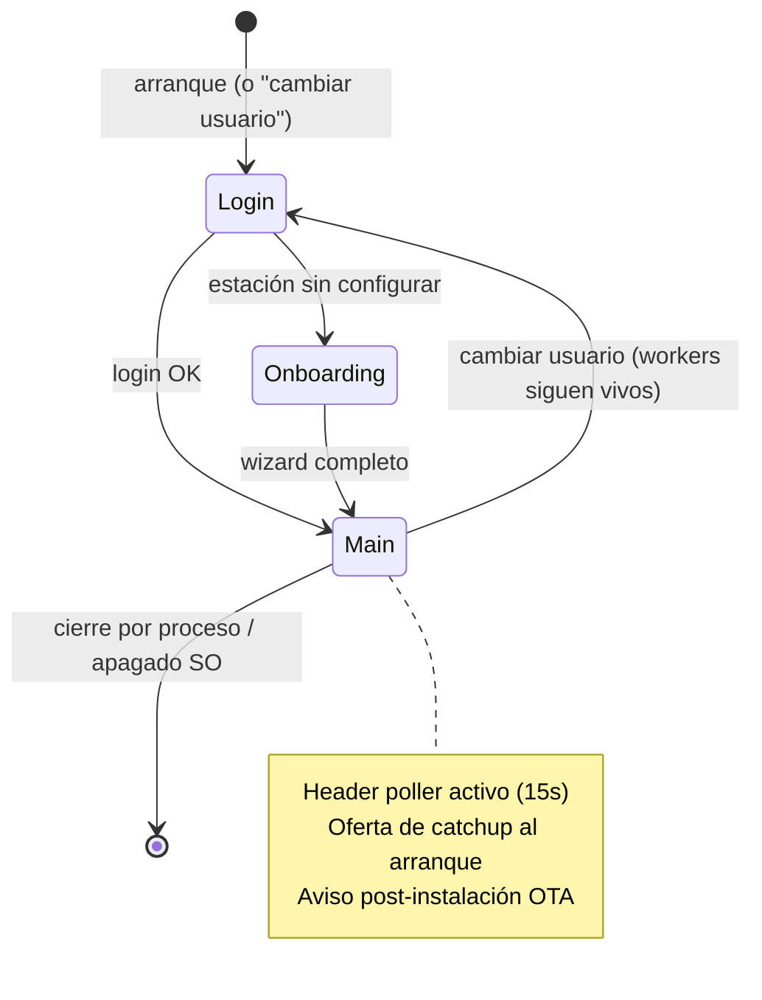

# 07 · Runtime, Bootstrap y Ciclo de Vida

**Propósito.** Cómo arranca y vive el proceso: el Composition Root que cablea
todo una vez, los tres daemons, el modelo de threading, y los estados de la
ventana.

**Alcance.** [`bootstrap.py`](../../src/yvy/bootstrap.py), la secuencia de
arranque (`scripts/launch_app.py`), y el ciclo de vida de `MainApplication`. Los
flujos de cada subsistema (sensor, sync, OTA) están en sus documentos.

**Dependencias.** [01](01_arquitectura_general.md), [04](04_application.md),
[05](05_infrastructure.md).

---

## 1. El Composition Root

Todo el sistema se cablea en **un solo lugar y una sola vez**:
`build_core_dependencies(root)` construye la infraestructura y la congela en un
`CoreDependencies` inmutable. Nadie más construye infraestructura (INV-CR-2).

`CoreDependencies` contiene: `root`, `db_path`, `factory`, `clock`, los 8
repositorios, `updates_service`, `station_uuid`. Los driving adapters lo reciben
entero.

- **INV-CR-1.** Un único Composition Root (`bootstrap.py`).
- **INV-RT-1.** El `root` que recibe el bootstrap es **`STABLE_ROOT`**, no el
  slot: de ahí cuelga `data/yvy.sqlite`. Las migraciones vienen del **código**
  (el slot, `MIGRATIONS_DIR`). Separar ambas raíces es INV-PATH-1.

---

## 2. Secuencia de arranque

- **`post_boot_check`** corre **antes** de levantar la GUI: si es el primer
  arranque tras un OTA, valida que la versión esperada haya arrancado y escribe (o
  no) el flag `boot_ok`. Es lo que permite al watchdog revertir. Detalle en
  [10 · OTA](10_ota_updates.md).
- Los daemons se levantan con **degradación elegante**: si falta el sensor o las
  credenciales, el daemon correspondiente no arranca y la UI **sigue operativa**.

---

## 3. Modelo de threading

El proceso corre **un hilo de UI (Tk) + tres daemons**. Toda la concurrencia es
intra-proceso; el aislamiento entre hilos lo da el contrato de conexión SQLite.

- **INV-RT-2.** Cada hilo (UI y cada daemon) usa **su propia** conexión SQLite
  vía la factory (INV-DB-1). Ninguna conexión cruza hilos.
- **INV-RT-3.** El trabajo diferido en la UI se agenda con Tk `after`; los
  controllers reciben ese `schedule` inyectado y **no** tocan el event loop
  directamente ([06 · §3](06_presentation_cli.md)).
- Un daemon nunca actualiza widgets Tk directamente: publica estado que el hilo
  de UI lee en su poller (ej. el `header_controller`).

---

## 4. Los tres daemons

| Daemon | Paquete | Responsabilidad | Documento |
|---|---|---|---|
| `SensorCollectorDaemon` | `infrastructure/scheduling/` | Captura periódica del WH1081 (live) y persistencia. | [08](08_adquisicion_y_persistencia.md) |
| `SyncAgentDaemon` | `infrastructure/sync/` | Envía los `SyncJob` pendientes a Core; máquina de estados con backoff. | [09](09_sincronizacion.md) |
| `UpdateCheckerDaemon` | `infrastructure/sync/` | Consulta a Core si hay `sync_version` nueva / paquete OTA. | [10](10_ota_updates.md) |

Se construyen en el arranque, se detienen ordenadamente al cerrar. `SyncAgent` y
`UpdateChecker` sólo arrancan si hay credenciales; su ausencia degrada, no rompe.

---

## 5. Ciclo de vida de la ventana

`MainApplication` es una máquina de estados de UI simple:

- **Cerrar la X no cierra la app.** Abre un modal (cambiar usuario / minimizar /
  cancelar). La app se mata por proceso o apagado del SO — así los daemons
  críticos (sync, retention) siguen vivos 24×7.
- **"Cambiar usuario"** vuelve al login sin matar los workers.
- Al entrar a *Main*: arranca el poller del header, se ofrece el catchup del
  buffer si hay hueco, y se muestra el resultado de una instalación OTA si es el
  primer arranque post-update.

**INV-RT-4.** El ciclo de polling del header no puede morirse: si una excepción
escapa de un tick, se reagenda igual (un header congelado en verde mentiría sobre
un sync caído). Ver [06](06_presentation_cli.md).

---

## 6. Decisiones arquitectónicas actuales

| Decisión | Estado | Por qué |
|---|---|---|
| Cableado único en bootstrap | `build_core_dependencies` | Sin construcción de infra dispersa (INV-CR-2). |
| Degradación elegante de daemons | Adoptada | Un nodo sin sensor o sin credenciales sigue usable. |
| La X no cierra; cierre por proceso | Modal de intercepción | Daemons 24×7 no se matan por accidente. |
| post_boot_check antes de la GUI | `RunPostBootCheckUseCase` | Permite al watchdog revertir un OTA fallido. |
| Trabajo diferido por `after` inyectado | `schedule` en controllers | Testeable sin event loop. |

---

## 7. Invariantes

- INV-RT-1: el bootstrap recibe `STABLE_ROOT`; migraciones desde el código.
- INV-RT-2: una conexión SQLite por hilo (UI + cada daemon).
- INV-RT-3: los controllers agendan por `schedule` inyectado, no tocan el loop.
- INV-RT-4: el poller del header sobrevive a una excepción de tick.

## 8. Puntos de extensión

- **Nuevo daemon:** hilo de larga vida en `infrastructure/`, arrancado en la
  secuencia de launch con degradación elegante, con su propia conexión SQLite.
- **Nuevo estado de UI:** se agrega a la máquina de `MainApplication`; la lógica
  no trivial va a un controller sin `tkinter`.

## 9. Reglas que no se rompen

- Un solo Composition Root; nadie más construye infraestructura (INV-CR-1/2).
- El bootstrap recibe la raíz **estable** (INV-RT-1 / INV-PATH-1).
- Una conexión SQLite por hilo (INV-RT-2).
