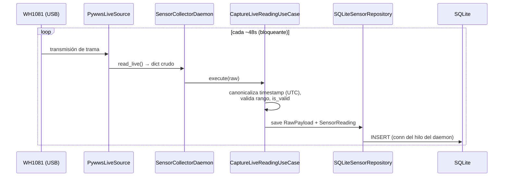
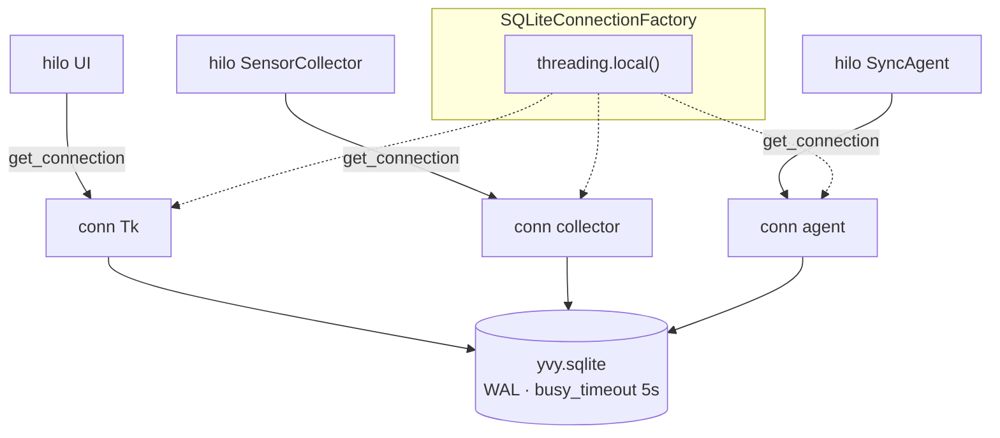
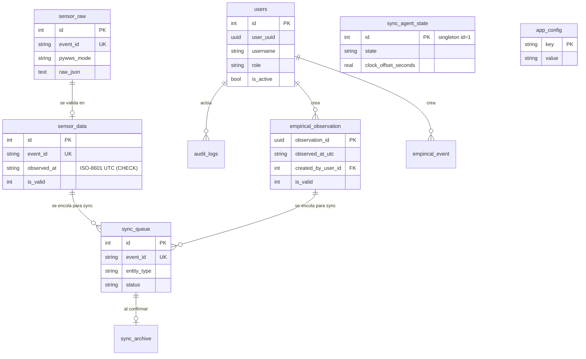

# 08 · Adquisición y Persistencia de Datos

**Propósito.** El viaje de una lectura: desde el sensor WH1081 hasta una fila
persistida y validada, y el modelo de datos que la guarda.

**Alcance.** `infrastructure/pywws/`, `infrastructure/scheduling/`,
`infrastructure/persistence/`, y el esquema SQLite (`migrations/`). Cubre la
adquisición (sensor) y el almacenamiento (SQLite + modelo de datos).

**Dependencias.** [03 · Domain](03_domain.md), [05 · Infrastructure](05_infrastructure.md),
[02 · Convenciones](02_convenciones_e_invariantes.md).

---

## 1. Flujo de captura de sensores

El `SensorCollectorDaemon` corre en su hilo, lee del WH1081 vía pywws, y persiste
crudo + validado.

- El WH1081 transmite cada **~48 s**; `read_live()` **bloquea** hasta la próxima
  trama, así que el daemon no necesita `sleep` adicional.
- **Crudo antes que validado** (INV-DOM-3): se guarda el `RawPayload` íntegro
  antes de interpretarlo. Si la validación cambia, el crudo sigue disponible.
- El timestamp se canonicaliza a **UTC** en la adquisición (INV-TIME-3); la hora
  local es asunto de la presentación.

**Modo catchup.** Además del *live*, `PywwsCatchupSource` recupera el **buffer
circular** del sensor (~14 días) cuando hubo un hueco —al arrancar tras estar
apagado—. La oferta de catchup al arranque la decide el `catchup_controller`
([06](06_presentation_cli.md)); una `SensorReading` inválida **no** cuenta como
instante cubierto (INV-DOM-3), así que el hueco que representa se vuelve a pedir.

---

## 2. Contrato de threading de SQLite

- **INV-DB-1.** Una conexión **por hilo** (`threading.local()`,
  `check_same_thread=True`). Una conexión no cruza hilos — hacerlo produce
  `ProgrammingError`.
- **INV-DB-2.** `SQLiteConnectionFactory` es el **único** contrato de
  construcción. Ningún repositorio abre su propia conexión.
- **INV-DB-3.** **WAL** (múltiples lectores + un escritor), `synchronous=NORMAL`,
  `busy_timeout=5000`. Escrituras atómicas con `BEGIN IMMEDIATE`.
- **Lecturas consistentes bajo concurrencia:** el estado que varios hilos leen y
  escriben (ej. el *pending* de update) se guarda como **una sola clave JSON**,
  no como múltiples `SELECT` que podrían leerse a medio actualizar.

---

## 3. Modelo de datos

Esquema SQLite, 8 migraciones (`v8` → `v15`). Tablas principales y sus
relaciones:

| Tabla | Rol |
|---|---|
| `users`, `sessions`, `audit_logs` | Identidad, sesión y auditoría (auth). |
| `sensor_raw` / `sensor_data` | Lectura cruda / validada del WH1081. `event_id` es UUID v5 (CHECK), `observed_at` ISO-8601 UTC forzado por CHECK. |
| `empirical_observation` / `empirical_event` | Observaciones y eventos humanos. |
| `sync_queue` / `sync_archive` / `sync_audit` | Cola de sincronización, archivo de enviados, auditoría de sync. |
| `sync_agent_state` | Estado singleton del agente (id=1). Ver [09](09_sincronizacion.md). |
| `update_log` | Bitácora de instalaciones/rollbacks OTA. Ver [10](10_ota_updates.md). |
| `app_config` | Configuración clave-valor (incluye el *pending* de update como clave JSON). |
| `app_metrics` | Métricas/telemetría del nodo. |

> Tablas legacy (`empirical_data`, `comments`) sobreviven por compatibilidad de
> migración; el código activo usa las tablas v11+.

---

## 4. Migraciones

`run_migrations()` aplica en orden las `NNN_*.sql` pendientes contra
`schema_version`. Las migraciones vienen del **código** (el slot,
`MIGRATIONS_DIR`), no de `STABLE_ROOT`; se corren en el arranque
(`run_migrations_on_start`, ver [07](07_runtime_bootstrap_ciclo_de_vida.md)).

- **INV-DATA-1.** El `observed_at` de `sensor_data` respeta un `CHECK`
  estructural: ISO-8601 con sufijo `Z`/`+00:00`. La lectura del último dato válido
  sale *timezone-aware* en UTC — un naive rompería las restas de tiempo del catchup.
- **INV-DATA-2.** `sensor_data.is_valid` distingue lectura descartada de instante
  cubierto (INV-DOM-3): las agregaciones y el catchup filtran por `is_valid = 1`.

---

## 5. Retención

`run_retention_job` purga datos viejos según `RetentionPolicy`. La purga de
`sensor_raw` es atómica (`BEGIN IMMEDIATE` + `DELETE` + `COMMIT`) y **no** toca
`sensor_data` (decisión de gobernanza: el dato validado se conserva). Ver
[03 · retention](03_domain.md).

---

## 6. Decisiones arquitectónicas actuales

| Decisión | Estado | Por qué |
|---|---|---|
| SQLite local con WAL | `SQLiteConnectionFactory` | Sin servidor; robusto ante cortes; concurrencia intra-proceso. |
| Conexión por hilo | `threading.local()` | Evita cross-thread `ProgrammingError`; cada daemon aísla su conn. |
| Crudo + validado separados | `sensor_raw` / `sensor_data` | El crudo sobrevive a cambios de validación. |
| Estado concurrente como clave JSON única | *pending* en `app_config` | Lecturas atómicas; sin *torn reads* de múltiples SELECT. |
| Migraciones desde el código | `MIGRATIONS_DIR` (slot) | El esquema viaja con la versión; los datos con `STABLE_ROOT`. |

---

## 7. Invariantes

- INV-DB-1/2/3: conexión por hilo, vía la factory, WAL + busy_timeout.
- INV-DATA-1: `observed_at` ISO-8601 UTC por CHECK; lectura aware.
- INV-DATA-2 / INV-DOM-3: `is_valid` separa descartada de cubierta.

## 8. Puntos de extensión

- **Nueva tabla / columna:** una migración `NNN_*.sql` nueva; el repo la consume
  vía la factory. Nunca alterar el esquema en runtime fuera de migraciones.
- **Nueva fuente de datos:** un adaptador que implemente `SensorSource` /
  `CatchupSource`, cableado en el Composition Root.

## 9. Reglas que no se rompen

- Una conexión SQLite por hilo, siempre desde la factory (INV-DB-1/2).
- Timestamps persistidos en UTC, `observed_at` con CHECK (INV-DATA-1, INV-TIME-3).
- El crudo se guarda antes de validar (INV-DOM-3).
