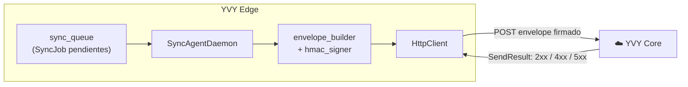
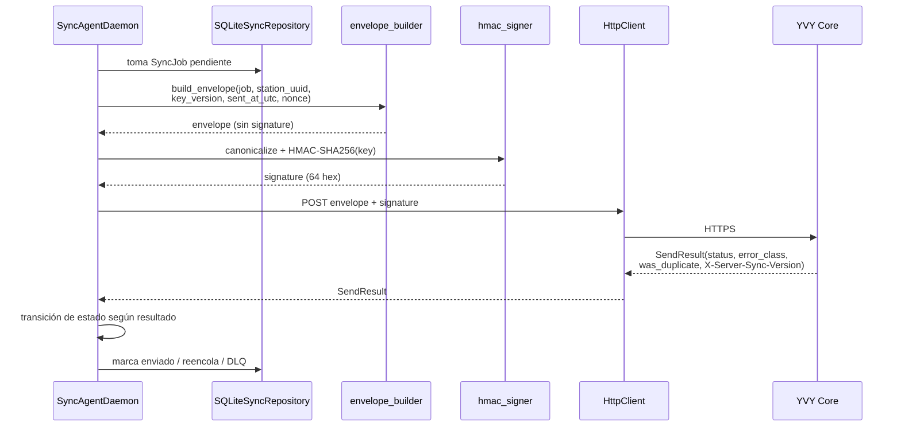
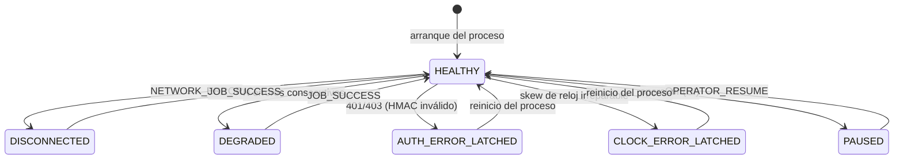

# 09 · Sincronización

**Propósito.** Cómo el nodo Edge envía sus datos al servidor Core: el sobre
firmado, la firma HMAC, y la máquina de estados del agente que gobierna reintentos
y fallos.

**Alcance.** `infrastructure/sync/` (excepto lo específico de OTA, que está en
[10](10_ota_updates.md)) y `domain/sync/`. La seguridad de las claves está en
[11 · Seguridad](11_seguridad.md).

**Dependencias.** [03 · Domain](03_domain.md), [05 · Infrastructure](05_infrastructure.md),
[07 · Runtime](07_runtime_bootstrap_ciclo_de_vida.md).

---

## 1. Modelo del canal

El canal es **pull firmado, iniciado por el Edge**: el nodo (típicamente detrás
de NAT, sin puerto abierto) inicia cada transacción. La autenticidad la da una
firma **HMAC-SHA256** que el server verifica; el Edge **genera** firmas, nunca
las compara.

---

## 2. Flujo de una sincronización

---

## 3. El sobre (envelope) y la firma

El envelope es un dict con **7 campos** (sin `signature`):

| Campo | Origen |
|---|---|
| `schema_version` | constante del builder |
| `event_id` | del `SyncJob` (UUID v5, idempotencia) |
| `station_uuid` | credenciales |
| `key_version` | credenciales |
| `sent_at_utc` | reloj, formato ISO-ms-Z (INV-TIME-1) |
| `nonce` | `secrets.token_hex(16)` por intento |
| `payload` | copia del payload del job |

- **INV-SYNC-1.** Se firma el **JSON canónico del envelope completo *menos*
  `signature`**. El server recanonicaliza lo recibido (sin `signature`),
  recomputa el HMAC y compara con `hmac.compare_digest`. Un byte de diferencia →
  rechazo `AUTH`.
- **INV-SYNC-2.** `sent_at_utc` es un **formato-contrato** byte-exacto
  (`iso_ms_z`, INV-TIME-1): se genera en un solo lugar del dominio, porque entra
  en los bytes firmados.
- **INV-SYNC-3.** El envelope pasado a firmar **no** contiene aún `signature`:
  incluirlo metería el campo en los bytes canónicos y rompería la verificación.
- **INV-SYNC-4.** `event_id` es la **clave de idempotencia**: reenviar el mismo
  job hace que el server responda `was_duplicate=true` sin duplicar el dato — por
  eso un timeout es seguro de reintentar.

`canonical_json.canonicalize()` produce los bytes byte-exactos (claves ordenadas,
separadores fijos); `hmac_signer.sign_envelope()` calcula la firma.

---

## 4. Máquina de estados del agente

El `SyncAgentDaemon` persiste su estado (`sync_agent_state`, singleton id=1) y
transiciona según el resultado de cada envío.

| Estado | Significado | Salida |
|---|---|---|
| `HEALTHY` | Operación normal. | — |
| `DEGRADED` | N errores consecutivos; mismo loop, logueado como degradado. | Un envío OK vuelve a HEALTHY. |
| `DISCONNECTED` | Errores de red; poll menos frecuente (ahorra CPU/log). | Un envío OK vuelve a HEALTHY. |
| `AUTH_ERROR_LATCHED` | El server rechazó el HMAC. **Latcheado.** | Sólo reinicio del proceso. |
| `CLOCK_ERROR_LATCHED` | Skew de reloj imposible de corregir por recalibración. **Latcheado.** | Sólo reinicio del proceso. |
| `PAUSED` | Pausado por el operador desde la UI. | `OPERATOR_RESUME` (sólo desde PAUSED). |

- **INV-SYNC-5.** Los estados *latcheados* **no** salen por ningún evento
  automático (ni `force_wakeup` ni `OPERATOR_RESUME`): sólo por reinicio. Un error
  de auth o de reloj que se auto-resolviera enmascararía un problema real.
- **INV-SYNC-6.** Los 4xx/5xx **no** son excepciones: son `SendResult` válidos
  que llevan información (`error_class`) que el agente necesita para decidir
  (latch en AUTH, recalibrar en CLOCK, DLQ en SCHEMA, backoff en SERVER). Sólo los
  problemas de transporte (red, timeout, body no-JSON) elevan excepción.

---

## 5. Reloj y recalibración

`clock_offset` mide el desfase contra el server (header `X-Server-Time`). Un skew
moderado se recalibra; uno irreparable latchea en `CLOCK_ERROR_LATCHED`. El
offset se muestra en el semáforo NTP del header ([06](06_presentation_cli.md)).

---

## 6. Backoff y reintentos

**Toda** la política de resiliencia (backoff, jitter, max intentos,
`next_retry_at`) vive en la **máquina de estados persistida del agente**, no en el
`HttpClient`. El cliente es un wrapper "tonto" de `httpx`: arma, envía, parsea,
clasifica y propaga. Sin reintento interno.

- **INV-SYNC-7.** El `HttpClient` no reintenta por su cuenta: si lo hiciera,
  `attempt_count` divergiría de los intentos reales, un crash a mitad dejaría un
  envío sin registrar, y habría dos fuentes de verdad para la política de
  reintentos.

---

## 7. Decisiones arquitectónicas actuales

| Decisión | Estado | Por qué |
|---|---|---|
| Pull firmado iniciado por Edge | Adoptada | El nodo tras NAT no necesita puerto abierto. |
| HMAC sobre el envelope canónico completo | `canonical_json` + `hmac_signer` | Autenticidad byte-exacta verificable en el server. |
| 4xx/5xx como `SendResult`, no excepción | `HttpClient` | El error del server lleva información de decisión. |
| Backoff en la máquina de estados, no en el cliente | `SyncAgentDaemon` | Una sola fuente de verdad para la resiliencia. |
| Estados latcheados sólo por reinicio | `AgentState` | Un auth/clock error no se auto-enmascara. |
| Idempotencia por `event_id` | UUID v5 | Timeout seguro de reintentar. |

---

## 8. Invariantes

- INV-SYNC-1..3: se firma el envelope canónico completo sin `signature`;
  `sent_at_utc` byte-exacto.
- INV-SYNC-4: idempotencia por `event_id`.
- INV-SYNC-5: latcheados sólo por reinicio.
- INV-SYNC-6: 4xx/5xx no son excepciones.
- INV-SYNC-7: sin reintento interno en el cliente.

## 9. Puntos de extensión

- **Nuevo tipo de entidad a sincronizar:** se encola como `SyncJob` con su
  `entity_type` y `payload`; el envelope y la firma no cambian.
- **Nueva transición de estado:** se agrega a la tabla de transiciones del
  `AgentState` (dominio), con su evento; sin tocar el transporte.

## 10. Reglas que no se rompen

- Se firma el envelope canónico completo sin `signature` (INV-SYNC-1/3).
- `sent_at_utc` con el formato-contrato, generado en el dominio (INV-SYNC-2, INV-TIME-1).
- El backoff vive en la máquina de estados, no en el cliente (INV-SYNC-7).
- Los estados latcheados no salen solos (INV-SYNC-5).
