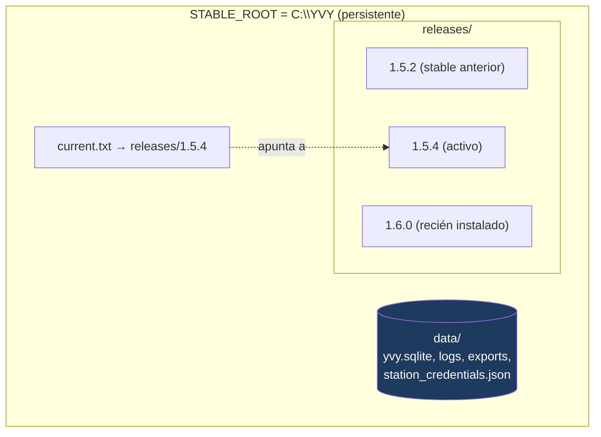
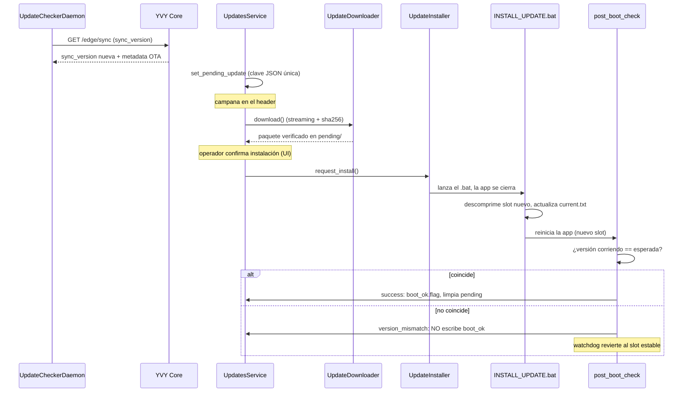

# 10 · OTA / Updates

**Propósito.** Cómo el nodo se actualiza solo, de forma **atómica y reversible**:
la arquitectura de slots, el ciclo descarga → instalación → verificación de
arranque → rollback, y el watchdog que revierte un update fallido.

**Alcance.** `infrastructure/updates/` (`UpdateInstaller`, `ReleaseRetention`),
`infrastructure/sync/update_downloader.py` + `update_checker_daemon.py`,
`application/services/updates_service.py`, `application/use_cases/updates/`. El
transporte HMAC hacia Core está en [09](09_sincronizacion.md).

**Dependencias.** [04 · Application](04_application.md), [07 · Runtime](07_runtime_bootstrap_ciclo_de_vida.md),
[09 · Sincronización](09_sincronizacion.md).

---

## 1. Arquitectura de slots

Cada versión vive en su **slot**; un puntero (`current.txt`) dice cuál está
activo. Los datos viven aparte y sobreviven a todos los updates (INV-PATH-1).

- **`CODE_ROOT`** = el slot activo (`releases/<ver>`): código, assets,
  migraciones. Cambia con cada OTA.
- **`STABLE_ROOT`** = `C:\YVY`: `data/`, DB, logs, credenciales. **Nunca** el slot.
- **INV-OTA-1.** Los datos cuelgan de `STABLE_ROOT`; sólo el código viaja con el
  slot. Confundirlos hace que tras un OTA el código apunte a una base vacía — la
  clase del incidente de pérdida de datos post-OTA (INV-PATH-2).

---

## 2. Ciclo de vida de un update

---

## 3. Descarga

`UpdateDownloader` baja el paquete por streaming y **verifica sha256** contra el
metadata firmado que vino de Core.

- **INV-OTA-2.** La verificación de hash es **case-insensitive** y usa el hasher
  canónico ([05 · §4](05_infrastructure.md)): un hex en mayúsculas de Core no
  debe pasar la descarga y fallar la instalación (un loop irrecuperable
  "re-descargar").
- El *pending* de update se guarda como **una sola clave JSON** en `app_config`
  (lecturas atómicas, sin *torn reads*); los flags de *descargado* son
  independientes del pending.

---

## 4. Instalación y post-boot

La instalación la ejecuta un `.bat` externo, no el proceso Python: la app se
cierra para liberar los archivos, el `.bat` monta el slot nuevo y actualiza
`current.txt`, y reinicia la app.

**El post-boot check es la red de seguridad.** Corre **antes** de la GUI
([07 · §2](07_runtime_bootstrap_ciclo_de_vida.md)) y devuelve uno de tres
resultados (`RunPostBootCheckUseCase`):

| Outcome | Condición | Acción |
|---|---|---|
| `no_install` | No hubo instalación pendiente. | Nada. |
| `success` | La versión corriendo == la esperada. | Cierra la instalación, limpia pending/descargado, **escribe `boot_ok.flag`**. |
| `version_mismatch` | El switch de slot no llevó a la versión esperada. | Marca fallida, la UI lo informa, **NO escribe `boot_ok`**. |

- **INV-OTA-3.** En `version_mismatch` **no** se escribe `boot_ok.flag` ni se
  limpia el pending: es exactamente lo que permite al **watchdog** revertir al
  slot estable. Escribirlo enmascararía el fallo.

---

## 5. Rollback y promoción a estable

- **`rollback(to_version, reason)`** — vuelve `current.txt` a un release anterior
  **ya en disco**, verificando que el slot destino existe y advirtiendo sobre
  posible incompatibilidad de esquema. Registrado en `update_log`.
- **Promoción a estable** — una versión que arrancó bien (`boot_ok`) se promueve
  a `last_stable`; el rollback de emergencia (`--to-stable`) apunta ahí.
- **`ReleaseRetention`** — poda slots viejos en disco, conservando el activo y el
  último estable.

- **INV-OTA-4.** `hero-rescue` y los comandos con `--db` por default apuntan a la
  base de `STABLE_ROOT`, no a la del slot: la recuperación de emergencia debe
  funcionar **después** de un OTA (INV-PATH-1).

---

## 6. Punto único: `UpdatesService`

Todo lo anterior se opera **sólo** a través de `UpdatesService`
([04 · §6](04_application.md)), construido una vez en el Composition Root. La GUI
(vía `update_flow_controller`) y el CLI (`update ...`) son sus dos consumidores.

- **INV-OTA-5.** La infraestructura de updates (`UpdateInstaller`,
  `ReleaseRetention`, `UpdateDownloader`) se construye **sólo** en el Composition
  Root (INV-CR-3). *Verificado por el gate AST, regla A.* Antes estaba dispersa
  entre UI/scripts/CLI, cada uno con su copia — el origen de los peores incidentes.

---

## 7. Decisiones arquitectónicas actuales

| Decisión | Estado | Por qué |
|---|---|---|
| Slots + `current.txt` | Adoptada | Update atómico; rollback = cambiar un puntero. |
| Datos fuera del slot | `STABLE_ROOT` | Los datos sobreviven a todos los updates. |
| post_boot_check antes de la GUI | `RunPostBootCheckUseCase` | Habilita el watchdog a revertir un OTA fallido. |
| Verificación sha256 case-insensitive | hasher canónico | Evita el loop "re-descargar" por diferencia de mayúsculas. |
| Pending como clave JSON única | `app_config` | Lecturas atómicas sin torn reads. |
| Operación sólo por `UpdatesService` | Construido en bootstrap | Sin infraestructura de updates dispersa (INV-CR-3). |

---

## 8. Invariantes

- INV-OTA-1: datos en `STABLE_ROOT`, código en el slot.
- INV-OTA-2: verificación de hash case-insensitive, hasher canónico.
- INV-OTA-3: `version_mismatch` no escribe `boot_ok` (permite el rollback).
- INV-OTA-4: recuperación de emergencia apunta a la base estable.
- INV-OTA-5: infraestructura de updates sólo en el Composition Root (gate AST A).

## 9. Puntos de extensión

- **Nuevo paso de instalación:** se agrega al `UpdateInstaller`, manteniendo la
  propiedad de que el post-boot pueda decidir `success`/`version_mismatch`.
- **Nuevo comando de update:** un método en `UpdatesService`, expuesto por la GUI
  (controller) o el CLI (handler); nunca construir infraestructura en el frente.

## 10. Reglas que no se rompen

- Datos en `STABLE_ROOT`, nunca en el slot (INV-OTA-1 / INV-PATH-1).
- `version_mismatch` no escribe `boot_ok` (INV-OTA-3).
- La infraestructura de updates se construye sólo en el Composition Root (INV-OTA-5).
