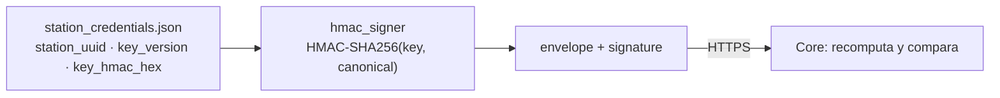

# 11 · Seguridad

**Propósito.** El modelo de seguridad del nodo: autenticación de la
sincronización, manejo de secretos, la salvaguarda física del sensor, y las
restricciones de datos personales y de lenguaje contractual.

**Alcance.** Transversal. Referencia los mecanismos descritos en
[09 · Sincronización](09_sincronizacion.md) y [06 · CLI](06_presentation_cli.md);
acá está la política.

**Dependencias.** [02 · Convenciones](02_convenciones_e_invariantes.md),
[09](09_sincronizacion.md).

---

## 1. Autenticación de la sincronización (HMAC)

El Edge se autentica ante Core firmando cada envelope con **HMAC-SHA256**. No hay
sesión ni token: cada mensaje se autentica por sí mismo.

- **INV-SEC-2.** Se firma el **JSON canónico del envelope completo sin el campo
  `signature`** (INV-SYNC-1). El Edge **genera** firmas; **nunca** compara (eso lo
  hace el server con `hmac.compare_digest`).
- La clave es **simétrica** y versionada (`key_version`): permite rotación sin
  downtime — Core acepta varias versiones durante la transición.
- `station_uuid` + `key_version` identifican qué clave usar; van en el envelope
  (no firmados aparte: el envelope entero se firma).

---

## 2. Manejo de secretos

- **INV-SEC-1.** `data/station_credentials.json` y la base
  (`*.sqlite`, `-wal`, `-shm`) **nunca** se commitean. Viven bajo `STABLE_ROOT`,
  fuera del árbol de código versionado.
- Las credenciales se instalan con el CLI `configure-sync` (idempotente; `--force`
  para sobrescribir, con backup `.bak`). El archivo se lee con `utf-8-sig`: puede
  venir con BOM si se editó con Notepad, y un BOM no manejado rompía la lectura.
- La clave HMAC (`key_hmac_hex`) sólo existe en ese archivo y en memoria del
  proceso; no se loguea, no se transmite.

---

## 3. Salvaguarda física del sensor

El WH1081 se conecta por USB y a veces requiere reemplazar el driver (Zadig,
`libusb-win32` vs `WinUSB`). Esa operación es peligrosa si se apunta al
dispositivo equivocado.

- **INV-SEC-3.** **Nunca** ejecutar *Replace Driver* sobre un dispositivo que no
  tenga **`VID=0x1941 PID=0x8021`**. Otro dispositivo con esos pasos podría ser un
  teclado o un mouse, y reemplazar su driver deja la netbook sin entrada. La
  herramienta de diagnóstico (`test sensor`) verifica el VID/PID antes de cualquier
  sugerencia de driver.

---

## 4. Autorización (roles)

La autorización es por **rol** (`SUPERADMIN > ADMIN > PROFESOR > ALUMNO`,
[03 · auth](03_domain.md)). `Permissions` deriva qué acciones habilita cada rol;
la UI oculta lo no permitido y los use cases lo verifican.

- Las acciones con efecto de gobernanza (login, cambio de usuario, alta de
  observación, rollback OTA) quedan en `audit_logs` (inmutable).
- Passwords: hash **bcrypt** (`BcryptPasswordHasher`), nunca en claro.
- **`hero-rescue`** (CLI) es un bypass de auth **de emergencia** para resetear el
  password admin/superadmin cuando la UI bloquea el acceso; corre localmente sobre
  la base estable, requiere acceso físico/consola al nodo.

---

## 5. Datos personales (PII) y paquete DNDA

- Datos de alumnos/docentes y el material del registro DNDA (que contiene PII:
  DNI, CUIT, domicilio, email) están **gitignoreados** y **nunca** se publican a
  GitHub ni a servicios externos.
- Los exports de datos son una acción administrativa auditada; el permiso de
  export de datos crudos es un flag por usuario (`can_export_raw`).

---

## 6. Lenguaje contractual

- **INV-LANG-1 / INV-DOM-5.** El sistema dice **"probable helada"**, nunca "helada
  confirmada". Es una restricción contractual: YVY **estima**, no certifica, y esa
  distinción tiene consecuencias de responsabilidad ante las escuelas y el IEA. La
  restricción vive en el dominio ([03 · observatorio](03_domain.md)), no como
  cosmética de UI.

---

## 7. Superficie de exposición

| Vector | Estado |
|---|---|
| Red entrante | **Ninguna.** El Edge nunca escucha; sólo inicia hacia Core (pull firmado). No hay puerto abierto. |
| Red saliente | HTTPS a Core, autenticado por HMAC. |
| USB | El WH1081 (lectura). Salvaguarda de driver por VID/PID. |
| Acceso local | Físico a la netbook: roles + `hero-rescue` como último recurso. |

---

## 8. Invariantes

- INV-SEC-1: credenciales y base nunca se commitean.
- INV-SEC-2: HMAC sobre el envelope canónico completo; el Edge sólo genera.
- INV-SEC-3: Replace-Driver sólo sobre VID/PID del WH1081.
- INV-LANG-1: "probable helada", nunca confirmada.

## 9. Puntos de extensión

- **Rotación de clave:** se instala una `key_version` nueva vía `configure-sync`;
  Core acepta ambas durante la transición. Sin cambio de código.
- **Nuevo rol / permiso:** se agrega al enum `Role` y a `Permissions` (dominio);
  la UI y los use cases lo consultan.

## 10. Reglas que no se rompen

- Credenciales y base fuera de git (INV-SEC-1).
- El Edge firma, nunca compara; envelope completo canónico (INV-SEC-2).
- Replace-Driver sólo sobre `VID=0x1941 PID=0x8021` (INV-SEC-3).
- "Probable helada", nunca confirmada (INV-LANG-1).
- PII y paquete DNDA nunca se publican.
