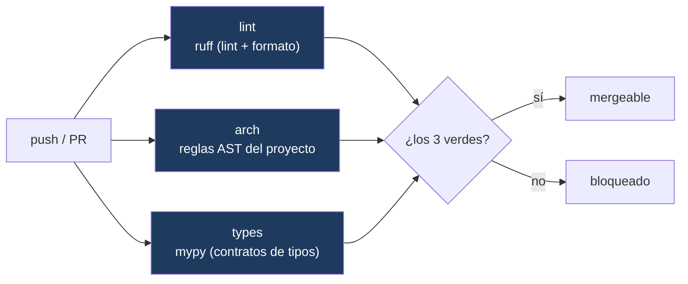
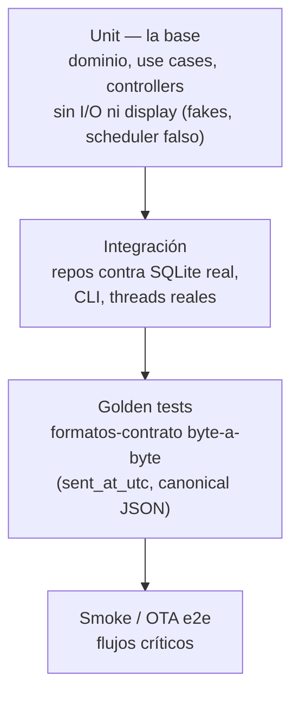

# 12 · Calidad, Testing y Observabilidad

**Propósito.** Cómo el proyecto se protege de regresiones: los tres gates de CI,
las reglas arquitectónicas verificadas por AST, la estrategia de testing, y el
modelo de logging/telemetría.

**Alcance.** El pipeline de CI (`.github/workflows/ci.yml`), el gate AST
(`scripts/check_arch_rules.py`), la config de tipos (`pyproject.toml`), la suite
de tests, y el logging del runtime.

**Dependencias.** [02 · Convenciones](02_convenciones_e_invariantes.md).

---

## 1. Pipeline de calidad (CI)

Tres gates **bloqueantes**. Antes de que existieran, el linter no protegía nada
—los "quality gates estaban invertidos"—; hoy ningún cambio entra sin pasarlos.

| Gate | Herramienta | Qué protege |
|---|---|---|
| `lint` | ruff (pinneado) | Estilo, formato, bugs sintácticos, y **PGH**: toda supresión (`type: ignore`/`noqa`) lleva código de error específico. |
| `arch` | `check_arch_rules.py` (AST, stdlib) | Reglas del **proyecto** que ningún linter conoce (§2). |
| `types` | mypy (pinneado) | **Contratos de tipos** sobre `domain`+`application`+`infrastructure`+`cli`. |

- **INV-CODE-1.** Los tres son bloqueantes; ninguno se saltea.
- **INV-CODE-3.** El alcance de cada gate **sólo crece**: bajar un nivel o sacar
  un paquete exige justificación documentada.

---

## 2. El gate arquitectónico (AST)

`check_arch_rules.py` verifica, parseando el AST (sin instalar el proyecto),
reglas que existen porque **su violación ya causó un incidente** o cerrarla costó
una iniciativa entera:

| Regla | Enunciado | Origen |
|---|---|---|
| **A** | La infraestructura del subsistema Updates se construye **sólo** en `bootstrap.py`. | El bug de pérdida de datos post-OTA (INV-CR-3). |
| **B** | `infrastructure/` no importa `presentation` ni `tkinter`. | La única inversión de capas del repo (DEP-3). |
| **C** | El formato ISO-ms-Z se produce **sólo** en `domain/shared/time_utils.py`. | Formato-contrato firmado con HMAC (INV-TIME-1). |
| **D** | Los widgets Tk clásicos se construyen con `bg` explícito. | Bugs de tema oscuro ilegible (INV-UI-1). |

Las cuatro son **bloqueantes en 0 violaciones**. El gate se auto-verifica: se
prueba inyectando una violación de cada regla y confirmando que la detecta.

---

## 3. Contratos de tipos (mypy)

El gate `types` corre sobre **cuatro paquetes**, todos en 0:
`domain` + `application` (strict) + `infrastructure` + `cli` (strict-lite).

- El **ratchet es de alcance** (la lista de paquetes), no de conteo: agregar
  anotaciones puede revelar errores aguas abajo, así que un ratchet numérico
  castigaría al que mejora. Un paquete entra a 0 y se queda en 0.
- **`presentation/` está fuera del gate** por decisión explícita: su deuda de
  tipos es mayormente pelea con stubs de terceros (matplotlib, PIL, Tk), y su
  valor —la frontera con `application`— ya está protegido desde el lado de
  `application`, que sí está en strict. Documentar la capa ≠ gatearla
  ([06](06_presentation_cli.md)).
- **INV-CODE-2.** Toda supresión lleva código de error y comentario de motivo
  (ruff PGH). Un `# type: ignore` que deja de suprimir se vuelve error
  (`warn_unused_ignores`).

---

## 4. Estrategia de testing

Pirámide de tests con verificación de **comportamiento real**, no sólo
compilación:

- **Decisión pura testeable sin I/O:** los controllers reciben `schedule`
  inyectado y puertos, así que se ejercitan sin abrir una ventana Tk (los que
  necesitan display se saltean con un guard).
- **Golden tests** fijan los formatos-contrato byte a byte: `iso_ms_z` sobre miles
  de datetimes, el JSON canónico del envelope. Un cambio de un byte los rompe —
  que es exactamente lo que protege la firma HMAC.
- **Verificación de comportamiento:** se ejercita el hilo real, la base real, el
  CLI real, el gate con violaciones inyectadas — no sólo que compile.
- Los tests están **fuera** del gate mypy (costo sin contrato: sus errores de
  tipo se manifiestan como fallos de test).

---

## 5. Observabilidad

El nodo corre 24×7 sin técnico en sitio: **los logs son la única telemetría**.

- **INV-ERR-1.** No hay `except Exception: pass` mudos en rutas con efecto: todo
  swallow **loguea** con contexto. La única excepción documentada es el hot loop
  por-widget del `theme_manager` (loguearlo spamearía).
- **INV-ERR-2.** Un callback diferido que captura `exc` de un `except ... as exc`
  lo liga explícitamente (`lambda exc=exc:`), o correría con `NameError` dentro del
  handler de error.
- Los logs cuelgan de `STABLE_ROOT/data/logs` (sobreviven a los OTA).
- `app_metrics` guarda métricas del nodo; el header muestra semáforos derivados
  (sensor, sync, NTP, conectividad) que un operador lee de un vistazo.

---

## 6. Decisiones arquitectónicas actuales

| Decisión | Estado | Por qué |
|---|---|---|
| 3 gates bloqueantes en CI | ruff, arch, mypy | Ningún cambio entra sin pasar calidad, reglas y tipos. |
| Gate AST propio | `check_arch_rules.py` | Reglas del proyecto que ningún linter genérico conoce. |
| Ratchet de alcance, no de conteo (mypy) | Lista de paquetes | El conteo de mypy no es monótono; castigaría al que mejora. |
| Golden tests para formatos-contrato | Adoptada | La firma HMAC depende de bytes exactos. |
| Logs como telemetría; sin swallows mudos | INV-ERR-1 | Nodo 24×7 sin técnico: el log es lo único que se ve. |

---

## 7. Invariantes

- INV-CODE-1/2/3: gates bloqueantes; supresiones con código; alcance sólo crece.
- INV-ERR-1/2: sin swallows mudos; ligar `exc` en callbacks diferidos.
- Las reglas AST (A–D) se verifican en 0 violaciones.

## 8. Puntos de extensión

- **Nueva regla de proyecto:** se agrega a `check_arch_rules.py` (AST), con su
  prueba de detección por inyección.
- **Sumar `presentation` al gate mypy:** válido a futuro (el alcance sólo crece);
  requiere saldar la deuda de stubs de terceros.
- **Nuevo gate** (ej. pytest en CI): se suma al workflow como job bloqueante.

## 9. Reglas que no se rompen

- Los 3 gates son bloqueantes; el alcance sólo crece (INV-CODE-1/3).
- Las 4 reglas AST en 0 violaciones.
- Sin swallows mudos; formatos-contrato cubiertos por golden tests (INV-ERR-1, INV-TIME-1).
