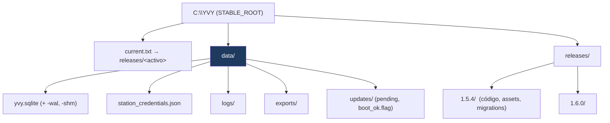

# 13 · Configuración y Deployment

**Propósito.** Cómo se configura y se despliega un nodo en la flota: las
variables de entorno, el layout en disco, los modos de instalación, y la
operación desatendida en Windows 24×7.

**Alcance.** `config/`, `infrastructure/system/paths.py`, el layout de slots, los
`.bat` de la flota, y la operación en la netbook. Enlaza a los manuales de
operador existentes.

**Dependencias.** [07 · Runtime](07_runtime_bootstrap_ciclo_de_vida.md),
[10 · OTA](10_ota_updates.md), [11 · Seguridad](11_seguridad.md).

---

## 1. Los dos modos de instalación

`resolve_stable_root(code_root)` distingue dos formas de correr el nodo:

| Modo | Layout | Cuándo |
|---|---|---|
| **Slot** | `C:\YVY\releases\<ver>\` (código) + `C:\YVY\` (datos) | Producción en la flota, con OTA. |
| **Flat / dev** | un solo directorio: código y datos juntos | Desarrollo, o instalación simple sin OTA. |

La detección es automática: si el padre de `CODE_ROOT` se llama `releases`, es un
slot y `STABLE_ROOT` son dos niveles arriba; si no, `STABLE_ROOT == CODE_ROOT`.

- **INV-DEPLOY-1.** La resolución de la raíz estable es determinística y tiene un
  override explícito (`YVY_ROOT`); nunca se "adivina" el directorio de datos en
  runtime fuera de esta función. Es la base de INV-PATH-1.

---

## 2. Layout en disco (producción)

- Bajo `data/` (persistente): la base, las credenciales, logs, exports, y el
  estado de updates. **Sobrevive a todos los OTA.**
- Bajo `releases/<ver>/` (el slot): código, `assets/`, `resources/`,
  `migrations/`, `deploy/`. **Viaja con la versión.**

---

## 3. Variables de entorno

| Variable | Efecto | Default |
|---|---|---|
| `YVY_ROOT` | Override explícito de `STABLE_ROOT`. | Auto-detección (§1). |
| `YVY_SYNC_URL` | URL base de YVY Core para `configure-sync`. | — (o `--server-url`). |
| `PYTHONIOENCODING` / `NO_COLOR` | Formato de salida del CLI (UTF/color). | Auto. |

- **INV-DEPLOY-2.** La configuración de runtime del nodo (URL de Core, modo de
  arranque) entra por env var o por el flujo de `configure-sync`/onboarding —
  nunca hardcodeada en el código versionado.

---

## 4. Arranque en la flota

Los `.bat` bajo el slot son el punto de entrada operativo:

- **`INICIAR.bat`** — lanza el proceso Python del slot activo (lee `current.txt`).
  Es lo que corre al encender la netbook.
- **`INSTALL_UPDATE.bat`** — ejecutado por el `UpdateInstaller`: la app se cierra,
  el `.bat` monta el slot nuevo, actualiza `current.txt` y reinicia
  ([10 · §2](10_ota_updates.md)).
- **`CONFIGURAR_SYNC.bat`** — envuelve el CLI `configure-sync` para instalar
  credenciales en el nodo.

- **INV-DEPLOY-3.** Los `.bat` detectan flat vs slot con la misma lógica que
  `resolve_stable_root` (la detección no está duplicada divergentemente entre el
  código y los scripts de arranque).

---

## 5. Operación 24×7 (Windows)

El nodo corre desatendido en una netbook, sin técnico en sitio:

- **La X no cierra la app** ([07 · §5](07_runtime_bootstrap_ciclo_de_vida.md)):
  se mata por proceso o apagado del SO, para que los daemons críticos (sync,
  retention) no se detengan por accidente.
- **Degradación elegante:** un nodo sin sensor o sin credenciales arranca igual y
  la UI es usable; el daemon faltante simplemente no corre.
- **Recuperación:** los datos sobreviven a cortes (SQLite WAL) y a updates
  (`STABLE_ROOT`); `hero-rescue` es el último recurso para recuperar acceso admin.
- Guía operativa: [`yvy_WINDOWS_24x7.md`](../yvy_WINDOWS_24x7.md).

---

## 6. Versionado

El versionado del nodo sigue [`POLITICA_VERSIONADO.md`](../POLITICA_VERSIONADO.md).
La versión instalada la reporta `python -m yvy version`; el post-boot check la
compara contra la esperada tras un OTA ([10 · §4](10_ota_updates.md)).

---

## 7. Manuales de operador (fuera de este documento)

La Arquitectura de Referencia describe *cómo está construido* el deployment. Los
procedimientos paso a paso viven en manuales de operador, que este documento
enlaza pero no absorbe (otra audiencia):

- [`MANUAL_INSTALACION_EDGE.md`](../MANUAL_INSTALACION_EDGE.md)
- [`configure_sync_GUIA.md`](../configure_sync_GUIA.md)
- [`yvy_CLI_GUIA.md`](../yvy_CLI_GUIA.md)
- [`yvy_WINDOWS_24x7.md`](../yvy_WINDOWS_24x7.md)

---

## 8. Decisiones arquitectónicas actuales

| Decisión | Estado | Por qué |
|---|---|---|
| Detección slot/flat determinística | `resolve_stable_root` | Un solo lugar decide dónde están los datos. |
| Config por env var / onboarding, no hardcode | `YVY_ROOT`, `YVY_SYNC_URL` | El mismo código sirve a toda la flota. |
| `.bat` como entry points | INICIAR / INSTALL / CONFIGURAR | Operación en Windows sin exponer Python al operador. |
| Operación desatendida 24×7 | X no cierra + degradación | Nodo sin técnico en sitio. |

## 9. Invariantes

- INV-DEPLOY-1: resolución de raíz estable determinística, con override `YVY_ROOT`.
- INV-DEPLOY-2: config por entorno/onboarding, no hardcodeada.
- INV-DEPLOY-3: detección flat/slot no duplicada divergentemente.
- INV-PATH-1: datos en `STABLE_ROOT`, código en el slot.

## 10. Puntos de extensión

- **Nueva variable de configuración:** se lee por env var o `app_config`, con
  default seguro; nunca hardcodeada en el código versionado.
- **Nuevo `.bat`:** reutiliza la detección flat/slot existente, no la reimplementa.

## 11. Reglas que no se rompen

- La raíz de datos se resuelve en un solo lugar (INV-DEPLOY-1 / INV-PATH-1).
- La configuración del nodo no se hardcodea (INV-DEPLOY-2).
- Los `.bat` no duplican la lógica de detección de raíz (INV-DEPLOY-3).
