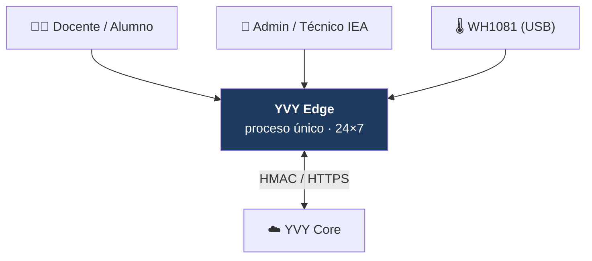

# Arquitectura de Referencia — YVY Edge

La documentación oficial de **cómo está construido YVY Edge hoy**. Es la fuente de
verdad para cualquier desarrollo futuro. Describe el sistema **tal como es**, no
cómo llegó a serlo.

> **Cómo leer.** Un desarrollador que nunca vio el proyecto lee **este índice** +
> **[01 · Arquitectura General](01_arquitectura_general.md)** para ubicarse, y de
> ahí baja **sólo** al documento que su tarea toca. No hace falta leer todo.

---

## Qué es YVY Edge

El nodo de estación meteorológica que corre en una netbook en cada escuela rural
del programa (Misiones). App **Python + Tkinter**, de **proceso único**, que opera
**24×7**: captura un sensor WH1081 por USB, valida y persiste las lecturas,
registra observaciones humanas, las sincroniza a un servidor central (YVY Core)
con firma HMAC, y se actualiza sola por un canal OTA basado en slots.
Arquitectura **hexagonal / DDD**.

---

## El conjunto de documentos

Organización **hub-and-spoke**: este índice + Arquitectura General son el centro;
el resto son referencias especializadas.

### Fundamentos
| # | Documento | Leé esto para… |
|---|---|---|
| 01 | [Arquitectura General](01_arquitectura_general.md) | La forma del sistema: capas, dependencias, C4, mapa de paquetes. |
| 02 | [Convenciones e Invariantes](02_convenciones_e_invariantes.md) | Las reglas que no se rompen. **Empezá acá si vas a tocar código.** |

### Capas (estructura: *qué existe*)
| # | Documento | Leé esto para… |
|---|---|---|
| 03 | [Domain](03_domain.md) | Modelos, subdominios, invariantes de negocio. |
| 04 | [Application](04_application.md) | Casos de uso, servicios, puertos. |
| 05 | [Infrastructure](05_infrastructure.md) | Catálogo de adaptadores. |
| 06 | [Presentation & CLI](06_presentation_cli.md) | GUI Tkinter y CLI (los driving adapters). |

### Runtime y subsistemas (comportamiento: *cómo corre*)
| # | Documento | Leé esto para… |
|---|---|---|
| 07 | [Runtime, Bootstrap y Ciclo de Vida](07_runtime_bootstrap_ciclo_de_vida.md) | Composition Root, daemons, threading, estados de la app. |
| 08 | [Adquisición y Persistencia](08_adquisicion_y_persistencia.md) | Sensor → validación → SQLite, y el modelo de datos. |
| 09 | [Sincronización](09_sincronizacion.md) | Envelope HMAC, máquina de estados del agente. |
| 10 | [OTA / Updates](10_ota_updates.md) | Slots, instalación, rollback, watchdog. |

### Políticas transversales
| # | Documento | Leé esto para… |
|---|---|---|
| 11 | [Seguridad](11_seguridad.md) | HMAC, credenciales, salvaguarda del sensor, PII, lenguaje contractual. |
| 12 | [Calidad, Testing y Observabilidad](12_calidad_testing_observabilidad.md) | Los 3 gates de CI, reglas AST, testing, logging. |
| 13 | [Configuración y Deployment](13_configuracion_deployment.md) | Env vars, layout de slots, operación Windows 24×7. |

---

## Qué documento tocar según qué cambió

| Cambiaste… | Revisá / actualizá |
|---|---|
| Un modelo o una regla de negocio | 03 Domain (y 08 si cambió el esquema) |
| Un caso de uso o un puerto | 04 Application |
| Un adaptador (SQLite, HTTP, pywws) | 05 Infrastructure + el subsistema (08/09/10) |
| La GUI o el CLI | 06 Presentation & CLI |
| El arranque, un daemon, el threading | 07 Runtime |
| El esquema / una migración | 08 Adquisición y Persistencia |
| El envelope, la firma, el agente | 09 Sincronización |
| El flujo de update / los slots | 10 OTA |
| Claves, credenciales, permisos | 11 Seguridad |
| Un gate, una regla AST, el tipado | 12 Calidad |
| Config, `.bat`, deployment | 13 Configuración y Deployment |
| **Una invariante de las de arriba** | **también 02**, en el mismo cambio |

---

## Principios de esta documentación

- **Descriptiva, no histórica.** Describe el estado actual. El *cómo se llegó* vive
  en los documentos históricos del repo (`AUDITORIA_*`, `PLAN_*`, `OTA_FIXES_*`),
  que esta referencia **no** cita.
- **Fuente de verdad con el código.** Ante discrepancia, el código gana y el
  documento se corrige. Cada documento nombra los archivos que describe.
- **Sin roadmap.** La única mirada al futuro es la sección *deuda conocida* de cada
  documento, cuando exista.
- **Nivel técnico:** asume Python y arquitectura hexagonal. Terminología precisa,
  sin conceptos básicos.

> El diseño de este conjunto (por qué 13 documentos, por qué esta división, el
> inventario de diagramas) está en
> [`../PLAN_DOCUMENTACION_ARQUITECTURA.md`](../PLAN_DOCUMENTACION_ARQUITECTURA.md).
